# Backend: reglas de negocio, estados y procesos

> Ciclos de vida y procesos tal como los implementa el backend (`Nexo.pro-Backend`). Cada transición está tomada del código: máquinas de estado, `update(... status ...)` y validaciones de los servicios. Las decisiones de producto de origen están en los ADR del backend (`docs/decisions/`). Lo que el código permite y parece raro figura como "Observación".

## 1. Cuenta: registro, activación y estado

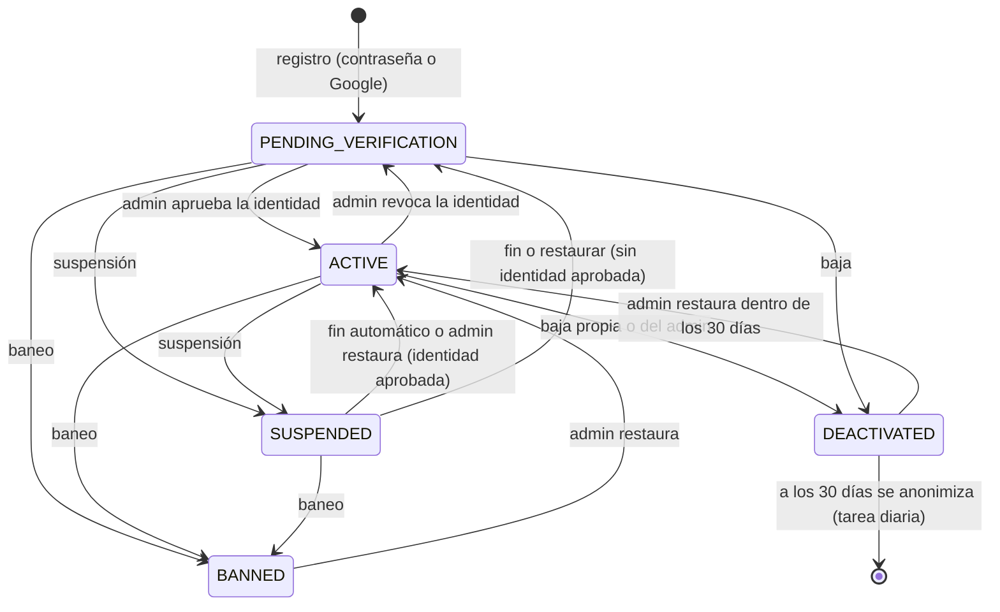

Evidencia:
- Suspender y banear: `src/users/accounts.service.ts:65-97`. Restaurar: `:147`.
- Fin automático de la suspensión: `endSuspension` `:104` (tarea horaria).
- Activación y revocación por la identidad: `src/identity-verification/identity-verification.service.ts:561`.
- Anonimización: `src/users/account-anonymizer.ts`.

**Registro** (`POST /auth/register`, `src/auth/services/registration.service.ts`):
- **Respuesta:** siempre `202` con el mismo mensaje, exista o no el email. Si existe, al dueño le llega un aviso por email.
- **Cliente:** manda `neighborhood: { localityId, name }`. Si el barrio no existe, se crea `PENDING`.
- **Profesional:** manda `professionId` y `serviceAreas` (1 a 20). Se le crea el perfil y una **prueba de 30 días** desde ese momento (ADR 0017).
- **Campos cruzados:** mandar los campos del otro rol da `400 VALIDATION_FAILED`.
- **Email:** llega un enlace de verificación (`/verificar-email?token=…`) que se confirma con `POST /auth/email/verify`.
- **Con Google** (`POST /auth/google/register`): el email ya llega verificado y la respuesta inicia sesión.

**Camino a `ACTIVE`** (el frontend tiene que guiarlo):
1. Verificar el email.
2. Subir la foto de perfil (`POST /uploads` con `purpose: AVATAR` → subir → `POST /uploads/:id/complete` → `PUT /users/me/avatar`).
3. Iniciar la verificación (`POST /identity-verification`). Exige email verificado y foto, con un máximo de 3 intentos.
4. Esperar la decisión del admin (`GET /identity-verification/me`). Al aprobarse, la cuenta pasa a `ACTIVE`.

**Baja propia** (`DELETE /users/me`):
- Pide la contraseña y cierra todas las sesiones.
- La cuenta queda `DEACTIVATED` 30 días; después se anonimiza: nombre "Cuenta eliminada", email ficticio y borrado de perfil, foro, favoritos y opinión de la plataforma.
- Las reseñas que escribió quedan con autor "Usuario eliminado".
- Las cuentas suspendidas o baneadas no pueden darse de baja.

## 2. Verificación de identidad

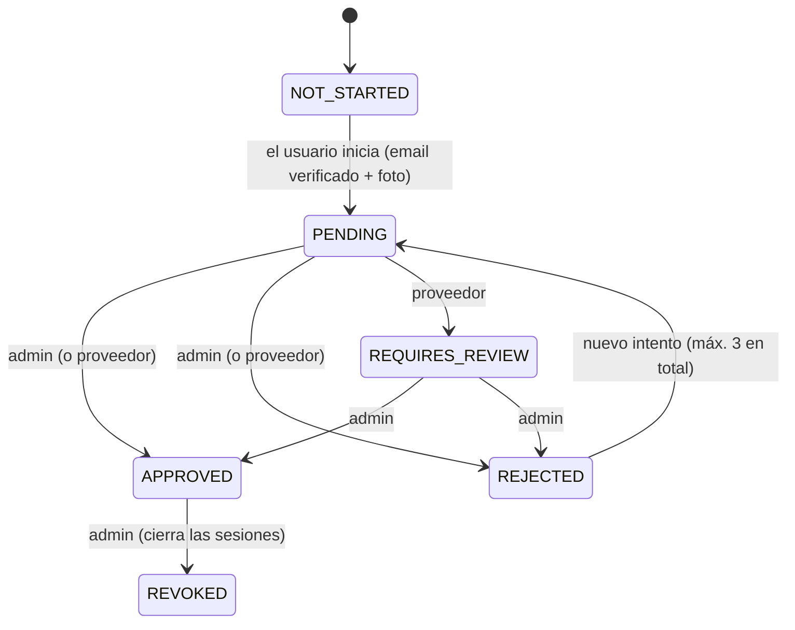

Evidencia: `src/identity-verification/verification-state-machine.ts`. Cualquier otra transición da `409`.

- **Cambio de foto o de nombre con la identidad aprobada** (ADR 0019 y 0021): queda en revisión del admin (`verificationStatus` `REQUIRES_REVIEW`, con `pendingAvatarFileId` o `pendingFirstName`). Mientras tanto la cuenta sigue activa y en público se ve lo anterior.
- **Proveedor:** el actual es **manual** (ADR 0003). No hay redirección ni SDK: el intento queda `PENDING` hasta que decide el admin.

## 3. Sesión: login, renovación y dispositivos

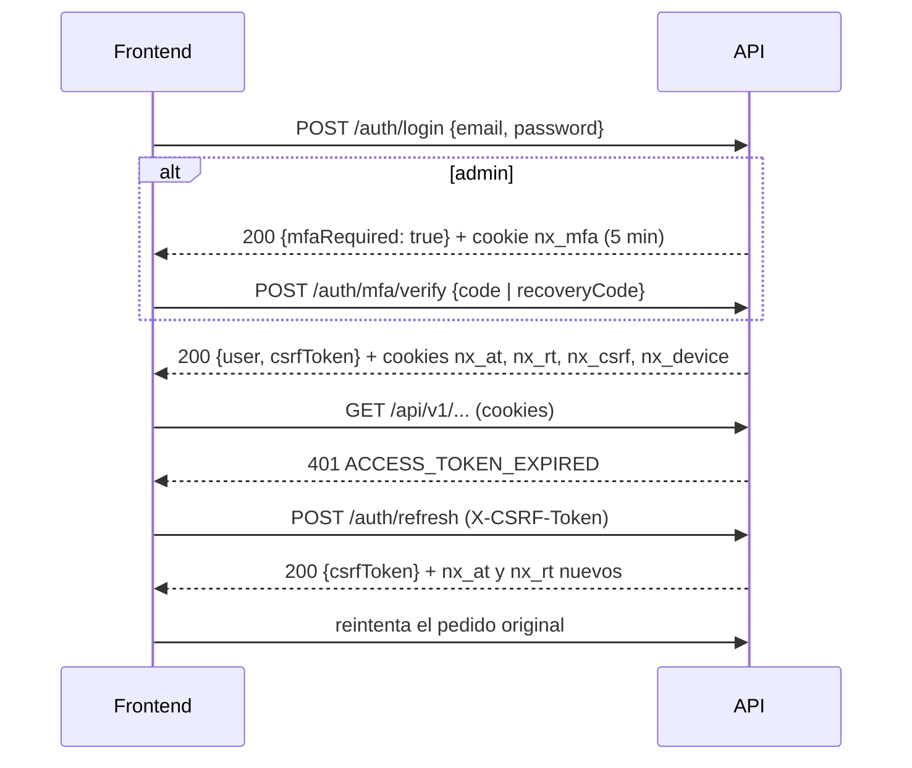

- **Duraciones** (`src/config/env.validation.ts`):
  - **Access:** 10 min (admin 5).
  - **Refresh:** 14 días sin uso (admin 12 h) y 30 días como máximo (admin 7).
- **Rotación del refresh:** en cada uso. Si un refresh ya rotado se presenta otra vez (pasados 10 s de gracia), se revoca todo ese dispositivo (`REFRESH_TOKEN_REUSED`).
- **Login fallido:** bloqueo progresivo por cuenta (5 fallos = 1 min, 10 = 15 min, 15 = 1 h) y límite de 5 por minuto por IP. Con 3 fallos desde una IP, CAPTCHA si está activado (`CAPTCHA_REQUIRED`). El mensaje es siempre `INVALID_CREDENTIALS`.
- **Dispositivos:**
  - **Límite:** hasta 10 por cuenta; al entrar con el 11, se cierra el que hace más tiempo no se usa.
  - **Ver y cerrar:** `GET /auth/sessions`, `DELETE /auth/sessions/:id` y `POST /auth/logout-all`.
- **Dispositivo nuevo** (ADR 0031): el email trae fecha, navegador, ciudad aproximada y un enlace a `/cerrar-sesion?token=…`. Esa página tiene un botón que hace `POST /auth/sessions/close-by-link`. No se manda en el primer inicio de sesión de la cuenta.
- **Contraseña:**
  - **Cambiarla:** cierra los demás dispositivos.
  - **Restablecerla:** la dispara el admin por email (`POST /admin/users/:id/password-reset`) y cierra todas las sesiones. El autoservicio (`/auth/password/forgot`) está **apagado**: responde 404.
  - **Cuentas solo Google:** crean contraseña con `POST /auth/password/set` (exige un login de menos de 10 min).

## 4. Archivos (subida en tres pasos)

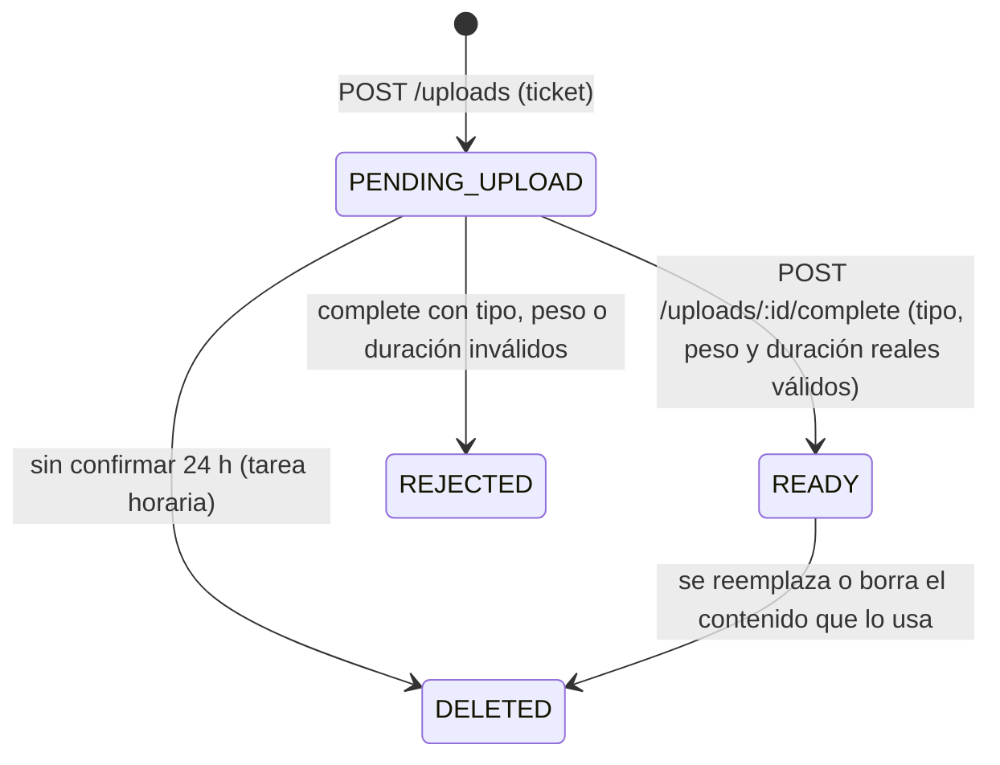

**Reglas** (`src/uploads/file-policies.ts`):
- **Propósitos:**

  | Propósito | Tipo | Visibilidad | Quién puede | Peso máximo |
  | --- | --- | --- | --- | --- |
  | `AVATAR` | imagen | pública | cliente y profesional | 5 MB |
  | `PROFILE_MEDIA` | imagen o video | pública | profesional con plan | según el plan: imágenes 5 MB (Premium 10), videos 30 MB (Premium 50) |
  | `CERTIFICATE` | imagen o PDF | pública | profesional con plan | 5 MB |
  | `CHAT_ATTACHMENT` | imagen o video | **privada** | cliente y profesional | imágenes 5 MB, videos 30 MB |
  | `FORUM_MEDIA` | imagen o video | pública | cliente y profesional | imágenes 5 MB, videos 30 MB |
  | `EVIDENCE` | imagen | **privada** | cliente y profesional | 5 MB |

- **Videos:** hasta 15 s.
- **Tipos admitidos:** JPEG, PNG y WebP; MP4 y QuickTime; PDF.
- **Subidas sin confirmar:** máximo 10 por usuario.
- **Un archivo `READY` se usa una sola vez:** reusarlo da `409 FILE_IN_USE`.

## 5. Plan y pagos del profesional

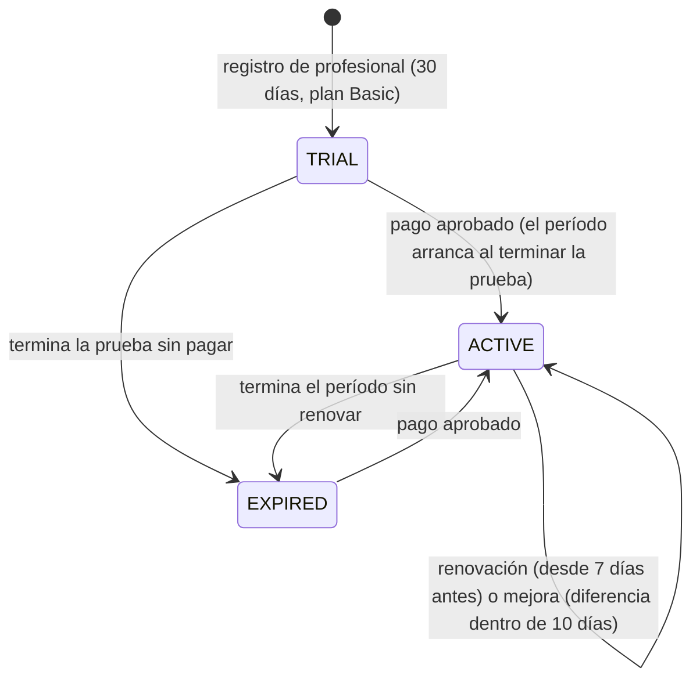

**Reglas del cobro** (`src/payments/subscription-ledger.ts`, ADR 0026):
- **Checkout manual mensual** con Mercado Pago. No hay débito automático, multa ni interés.
- **Cada pago da 30 días.** En prueba o vencida se paga el mes completo. Con período vigente:
  - plan más caro dentro de los 10 días del último pago: se paga la **diferencia** y el cambio es inmediato;
  - si no: el mes siguiente, recién desde 7 días antes del vencimiento (`RENEWAL_NOT_YET` / `UPGRADE_WINDOW_CLOSED`).
- **Bajar de plan:** rige al empezar el período pagado; lo que excede el plan nuevo queda `HIDDEN_BY_PLAN` y no se borra. El profesional elige qué mostrar (`PUT /professionals/me/media/visible` y `/professions/visible`).
- **`GET /subscriptions/plans`** dice para cada plan si se puede pagar, cuánto y con qué propósito.

**Pago:**

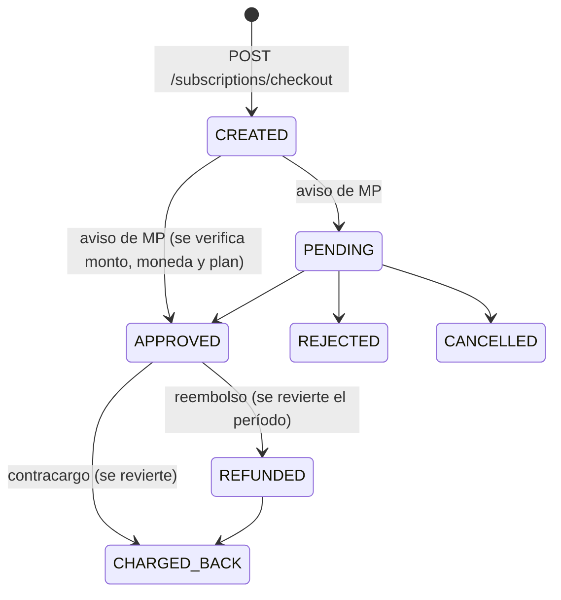

- **El frontend solo crea el checkout y redirige a `checkoutUrl`.** El estado real lo fija el webhook de Mercado Pago, que llama al backend.
- **Al volver de Mercado Pago:** la persona llega a `<FRONTEND_URL>/suscripcion/resultado`. Hay que consultar `GET /subscriptions/me` y no confiar en los parámetros de la vuelta.
- **Si monto, moneda o plan no coinciden:** el pago no se aplica y se avisa al admin.

## 6. Chat

- **Abrirlo:** solo el cliente (`POST /chat/conversations`) y solo con un profesional del catálogo. Hay una conversación por pareja cliente-profesional; volver a abrirla devuelve la misma.
- **Mensajes:**
  - texto de hasta 2000 caracteres y/o hasta 5 adjuntos `CHAT_ATTACHMENT`;
  - **editar**, solo el autor y dentro de 15 minutos (`EDIT_WINDOW_EXPIRED`); **borrar**, siempre, y desaparece para los dos;
  - la versión original se guarda para el admin (ADR 0024).
- **Mensajes de sistema** (`senderType: SYSTEM`): los generan las solicitudes y contrataciones (pedido nuevo, presupuesto, selección, cancelación, cambios de estado). Llevan `serviceRequestId`.
- **Si el profesional no tiene plan:**
  - el cliente sigue leyendo; `canWrite: false` y `PROFESSIONAL_UNAVAILABLE` al escribir;
  - excepción: con una contratación en curso hablan los dos hasta que se cierre (C-12).
- **Si la otra parte dio de baja su cuenta** (incluidos los 30 días para arrepentirse): el chat se sigue viendo, de solo lectura (`counterpart.deactivated: true`, `canWrite: false`). Al escribir, `PROFESSIONAL_UNAVAILABLE` o `CUSTOMER_UNAVAILABLE`. Una vez anonimizada, se llama «Cuenta eliminada», sin foto, y el profesional no tiene `slug`.
- **Lectura:** `POST /chat/conversations/:id/read` avisa al otro (`conversation:read`). Hay una sola notificación de "mensaje nuevo" por chat hasta que se lea.
- **Tiempo real:** solo avisa (`message:new`, `message:updated`, `conversation:read`, `notification:new`). Los mensajes se envían siempre por REST.

## 7. Solicitudes, presupuestos y contrataciones

**Pedido y negociación** (`src/requests/requests.service.ts`, ADR 0025):

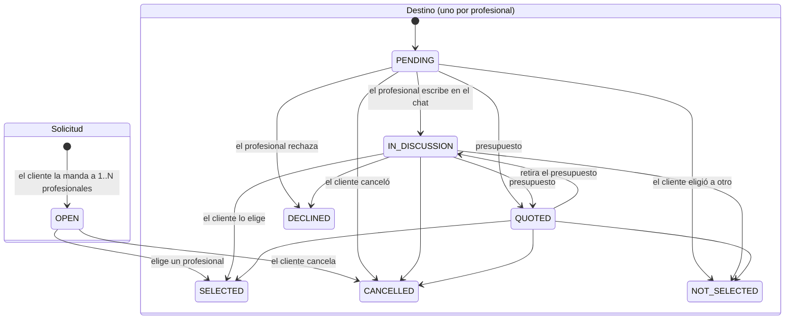

- **Crear:** solo profesionales listados que ofrecen ese oficio (`PROFESSION_NOT_OFFERED`). Cada destino va en el chat de la pareja, con un mensaje de sistema.
- **Presupuesto:** uno vigente por destino; mandar otro reemplaza al anterior (`SUPERSEDED`). Estados de un presupuesto: `SENT`, `SUPERSEDED`, `WITHDRAWN`, `ACCEPTED`, `REJECTED`.
- **Elegir:** solo a un profesional que respondió (`IN_DISCUSSION` o `QUOTED`) y que está disponible (activo y con plan).
  - Se acepta el presupuesto indicado, o ninguno.
  - Los demás destinos pasan a `NOT_SELECTED`, con el mensaje "El cliente {nombre} ya seleccionó a un profesional".
  - **Nace la contratación.**
- **Cancelar el pedido:** si nadie respondió todavía, el mensaje automático es "Ya lo solucioné, disculpas por la molestia" (FI §11.1).

**Contratación** (`src/requests/contract-state-machine.ts`):

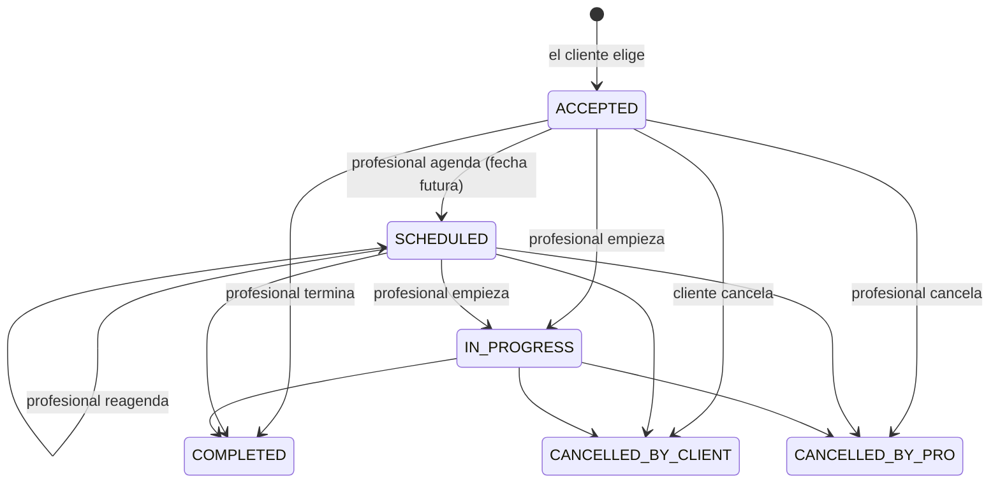

- **Quién avanza:**
  - solo el profesional agenda, empieza y termina; **no hace falta que el cliente confirme** (FI §11.4);
  - los dos pueden cancelar mientras no terminó.
- **Cada transición:**
  - queda en `service_contract_history`;
  - genera un mensaje de sistema en el chat;
  - le avisa a la otra parte.
- **Al empezar:** la respuesta trae `suggestedAttentionStatus: "WORKING"`; el estado de atención no cambia solo (C-30).
- **Observación:** se puede terminar directamente desde `ACCEPTED`, sin pasar por `IN_PROGRESS`. Lo permite la tabla de transiciones a propósito (FI §11.4), pero el frontend no tiene que asumir que existe el paso "en curso".

## 8. Reseñas y opiniones

- **Reseña:**
  - solo de una contratación **terminada** propia;
  - una por contratación;
  - 1 a 5 estrellas y un comentario opcional.
- **Plazos:**
  - **Crear y editar:** dentro de los 30 días desde que terminó (`REVIEW_WINDOW_CLOSED`).
  - **Borrar:** siempre.
- **Estados:** `VISIBLE` o `HIDDEN_BY_ADMIN`, más el borrado lógico. Al profesional le llega `REVIEW_RECEIVED`.
- **Respuesta del profesional:** una, que se reemplaza o se borra; exige plan vigente. El cliente recibe `REVIEW_REPLIED`.
- **Promedio:** se calcula al leer; solo cuentan las reseñas visibles.
- **Opinión sobre la plataforma:** una por usuario. No se publica hasta que la publica el admin, y editarla la despublica (`PlatformReviewsService.upsert`).

## 9. Foro

- **Tipos:** `QUESTION` y `PROFESSIONAL_WANTED`, con oficios, zona, presupuesto estimado, fecha límite y hasta N fotos `FORUM_MEDIA`.
- **Quién participa:** publicar, responder y dar "me gusta" es para clientes activos y profesionales con plan. Leer es público.
- **Resuelta:** deja de admitir respuestas pero sigue visible.
- **Borrado:**
  - es lógico;
  - el admin oculta y restaura;
  - una respuesta borrada u oculta queda como "lugar vacío" solo si alguien le contestó.
- **"Me gusta":** `PUT` / `DELETE`. `GET /forum/posts/:id/my-likes` dice cuáles marcó el usuario, porque la lectura pública no sabe quién es.

## 10. Favoritos y avisos de disponibilidad

- Solo clientes, y solo profesionales del catálogo.
- **Aviso de disponibilidad:** se activa por favorito y solo funciona si el plan del profesional lo incluye (`alertsAvailable`).
- **Cuándo llega:** cuando el profesional se pone "Disponible" **a mano**. El cambio por horario no avisa (pendiente).

## 11. Estado de atención

`AVAILABLE`, `WORKING` y `RESTING`. El estado que se muestra se calcula al leer (`src/professionals/attention-status.ts`):
- **Manual:** vale hasta `attentionStatusUntil`; vencido, "Descansando".
- **Con horario automático:**
  - un estado manual vigente manda;
  - un día sin atención (excepción) da `RESTING`;
  - dentro de una franja del horario da `AVAILABLE`, y fuera, `RESTING`.

El horario usa la hora de Córdoba; los días van de 1 (lunes) a 7 (domingo).

## 12. Moderación

**Reportes** (ADR 0029):

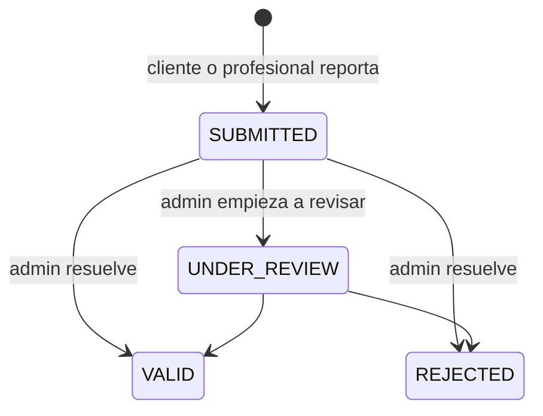

- **Qué se reporta:** `PROFILE` (el id es el del usuario), `MESSAGE`, `FORUM_POST`, `FORUM_REPLY` y `REVIEW`.
- **Motivos:** `DISCRIMINATION`, `DISRESPECT`, `HARASSMENT`, `NO_SHOW`, `NOT_AS_AGREED`, `FRAUD`, `THREATS`, `OFFENSIVE_CONTENT`, `SPAM` y `OTHER`.
- **Evidencia:** hasta 3 fotos `EVIDENCE`.
- **Límite:** un reporte abierto por persona y contenido.
- **El denunciado:**
  - nunca ve quién lo reportó;
  - solo recibe `REPORT_UPHELD` si el reporte es válido.
- **El denunciante:** recibe `REPORT_RESOLVED`.

**Strikes y sanciones** (siempre manuales, sin umbrales automáticos):
- **Strike:** peso de 1 a 3; se puede anular con motivo.
- **Sanciones:** `WARNING`, `SUSPENSION` (con o sin fecha de fin), `BAN` y `PROFILE_HIDDEN` (con o sin fecha; solo para profesionales).
- **Efecto en la cuenta:** la suspensión y el baneo cambian el estado y cierran las sesiones; las que tienen fecha de fin se levantan solas (tarea horaria).
- **Apelaciones:** `OPEN` → `ACCEPTED` (anula el strike o levanta la sanción) / `REJECTED`. Se puede apelar también suspendido o baneado.

**Contenido de perfiles:**
- **Medios:** `ACTIVE` / `HIDDEN_BY_PLAN` / `HIDDEN_BY_ADMIN`.
- **Certificados:** `ACTIVE` / `HIDDEN_BY_ADMIN`.

Ocultar pasa el archivo a privado en el almacenamiento.

**Barrios:**

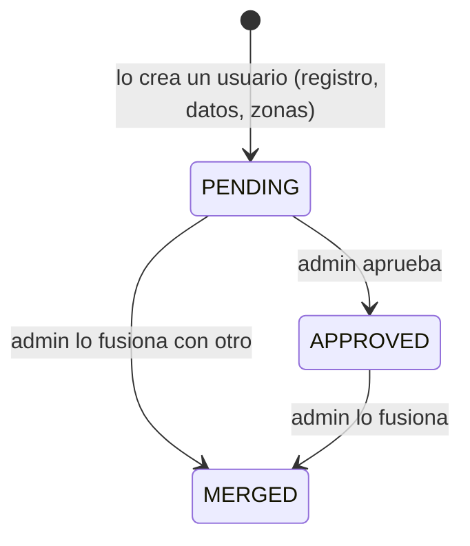

- **Visibilidad:** los pendientes no aparecen en búsquedas públicas ni en el perfil público.
- **Renombrar:** el admin puede renombrar uno con motivo.

## 13. Soporte y novedades

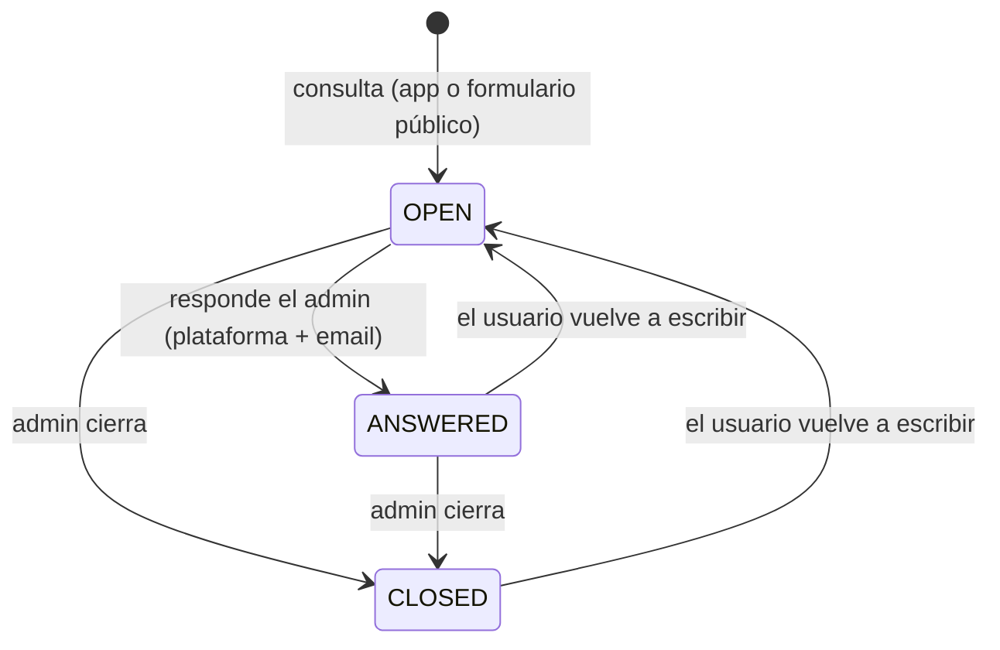

- **Categorías:** `SUGGESTION`, `BUG`, `INCIDENT`, `COMPLAINT` y `OTHER`.
- **Formulario público:** 3 por hora por IP, con CAPTCHA si está activado.
- **Plazo que se comunica:** 48 a 72 horas hábiles.
- **Novedades:** el admin publica a todos o a un segmento (rol, profesión, plan). Llegan como notificación `ANNOUNCEMENT` y el texto completo se lee con `GET /announcements/:id`.

## 14. Notificaciones

- **Tipos:**
  - `NEW_MESSAGE`, `NEW_REQUEST`, `QUOTE`, `CONTRACT_UPDATED`, `SUBSCRIPTION_UPDATED`, `PAYMENT_ALERT`;
  - `REVIEW_RECEIVED`, `REVIEW_REPLIED`, `FORUM_REPLY`, `PROFESSIONAL_AVAILABLE`;
  - `REPORT_RESOLVED`, `REPORT_UPHELD`, `MODERATION_ACTION`, `APPEAL_DECIDED`, `MODERATION_ALERT`;
  - `SUPPORT_REPLY`, `ANNOUNCEMENT`, `ADMIN_MESSAGE`, `SECURITY_ALERT`.
- **Qué traen:** `targetType` y `targetId` para navegar al recurso.
- **Ciclo:** se marcan como leídas, nunca se borran.
- **Canales:**
  - **Push web:** se manda la misma notificación (mismo título y texto) salvo que la persona tenga la app abierta o haya apagado esa categoría (ADR 0032).
  - **Email:** solo los de autenticación, la respuesta de soporte y las alertas de seguridad al admin.
  - **WhatsApp:** no existe.

## 15. Métricas Premium

- **Qué se cuenta** (ADR 0033): personas distintas por día que abrieron el perfil, que lo vieron en resultados y que lo vieron primero.
  - Recargar no suma.
  - No cuentan el propio profesional, el admin ni los robots.
- **Qué se calcula de sus tablas:** pedidos, trabajos terminados y reseñas del período.
- **Quién las ve:** el profesional, solo con un plan con métricas (Premium); el admin, cualquiera.

## 16. Tareas programadas (efectos que el frontend ve sin pedirlos)

| Tarea | Cuándo (Córdoba) | Efecto visible |
| --- | --- | --- |
| Purga de cuentas | 3:00 | Cuentas `DEACTIVATED` con la gracia vencida pasan a "Cuenta eliminada" |
| Limpieza de sesiones | 4:00 | Desaparecen sesiones vencidas y suscripciones push sin sesión |
| Limpieza de métricas | 4:30 | Se borran días de más de 25 meses |
| Pruebas y recordatorios | 9:00 | Vence la prueba; recordatorios 7, 3 y 1 día antes |
| Archivos | cada hora | Se descartan subidas sin confirmar de más de 24 h |
| Períodos pagos | cada hora | Vence el período; rige el plan elegido al renovar |
| Sanciones | cada hora | Se levantan suspensiones y perfiles ocultos con fecha de fin |
| Alertas de seguridad | cada 15 min | Notificación y email al admin ante picos |
| Guardado de métricas | cada minuto | Las visitas aparecen en las métricas con hasta 1 minuto de demora |
