# Backend: entidades, relaciones y datos

> Modelo de persistencia del backend (`Nexo.pro-Backend`), leído de las entidades de TypeORM y de las migraciones SQL. **Esto no es lo que recibe el frontend:** la API nunca devuelve entidades, arma DTOs de respuesta a mano (ver `BACKEND_ENDPOINTS.md`, anexo A). Este documento sirve para entender qué datos existen, cómo se relacionan y qué no debe mostrarse nunca.

## Cómo está construido

- **PostgreSQL 17** con **TypeORM 1.1.2**, `synchronize: false`: el esquema lo definen solo las migraciones escritas a mano en `src/database/migrations/`. Son 26 y van de `1793640000000-InitDatabase` a `1793640025000-ProfessionalMetrics`. Un test de integración compara las entidades con la base real.
- **Nombres:** tablas y columnas en `snake_case` (`SnakeNamingStrategy`); restricciones con prefijo `pk_`, `fk_`, `uq_`, `ix_` y `ck_`.
- **IDs:** `uuid` generados por la base (`gen_random_uuid()`), salvo tablas de clave compuesta (`notification_preferences`, `professional_metrics_daily`) o clave igual a la del usuario (`user_mfa_settings`, `customer_profiles`).
- **Relaciones:**
  - **Todas son `ManyToOne`** desde el lado que tiene la FK. No hay `OneToMany` ni `ManyToMany` declaradas.
  - **Las 1:1** se garantizan con `UNIQUE` o con la clave primaria. Un usuario tiene como máximo un `customer_profiles` y un `professional_profiles`.
  - **Las N:M** son tablas explícitas con datos propios: `professional_professions`, `forum_post_professions`, `favorites`, `forum_post_likes` y `forum_reply_likes`.
- **`ON DELETE`:** casi todas las FK son `RESTRICT`. Solo son `CASCADE` las tablas descartables de sesión: `auth_sessions`, `one_time_tokens`, `user_mfa_settings`, `push_subscriptions` y `notification_preferences`. Los usuarios nunca se borran físicamente, así que en la práctica no se dispara ninguna cascada.
- **Borrado lógico:**
  - **`users.deleted_at`:** marca la cuenta anonimizada (`@DeleteDateColumn`). TypeORM excluye esas filas de los `find` salvo con `withDeleted`; esto tiene consecuencias, ver los hallazgos H-02 y H-13 en `BACKEND_AUDIT.md` (resueltos: las lecturas de la otra parte del chat y de sanciones usan `withDeleted`).
  - **Contenido:** `forum_posts`, `forum_replies`, `reviews` y `messages` usan `deleted_at` y además un `status` de moderación (`VISIBLE` / `HIDDEN_BY_ADMIN`).
- **Auditoría:** `admin_audit_logs` es append-only (un trigger rechaza UPDATE, DELETE y TRUNCATE). **Ningún endpoint la expone.**
- **Historiales:** `subscription_history`, `service_contract_history` y los eventos de proveedores (`payment_events`, `identity_provider_events`).
- **Montos:** `numeric(12,2)`; la API los devuelve como **texto** (`"15000.00"`).

## Diagrama de relaciones principales

```mermaid
erDiagram
  users ||--o| customer_profiles : "cliente"
  users ||--o| professional_profiles : "profesional"
  users }o--o| neighborhoods : "barrio (cliente)"
  professional_profiles ||--o{ professional_professions : ""
  professions ||--o{ professional_professions : ""
  professional_profiles ||--o{ professional_service_areas : "zonas"
  localities ||--o{ professional_service_areas : ""
  provinces ||--o{ localities : ""
  localities ||--o{ neighborhoods : ""
  professional_profiles ||--o{ professional_media : ""
  professional_profiles ||--o{ professional_certifications : ""
  professional_profiles ||--o{ professional_social_links : ""
  professional_profiles ||--o{ availability_slots : ""
  professional_profiles ||--o{ availability_exceptions : ""
  professional_profiles ||--o{ professional_metrics_daily : "métricas"
  users ||--o{ subscriptions : "profesional"
  subscription_plans ||--o{ subscriptions : ""
  subscriptions ||--o{ payments : ""
  subscriptions ||--o{ subscription_history : ""
  users ||--o{ conversations : "cliente / profesional"
  conversations ||--o{ messages : ""
  messages ||--o{ message_attachments : ""
  stored_files ||--o{ message_attachments : ""
  users ||--o{ service_requests : "cliente"
  service_requests ||--o{ service_request_targets : "un destino por profesional"
  service_request_targets ||--o{ quotes : "presupuestos"
  service_request_targets ||--o| service_contracts : "contratación"
  service_contracts ||--o{ service_contract_history : ""
  service_contracts ||--o{ reviews : "reseña"
  users ||--o{ favorites : "cliente → profesional"
  users ||--o{ forum_posts : "autor"
  forum_posts ||--o{ forum_replies : ""
  users ||--o{ reports : "denunciante / denunciado"
  reports ||--o{ report_evidence : ""
  users ||--o{ strikes : ""
  users ||--o{ sanctions : ""
  users ||--o{ appeals : ""
  users ||--o{ support_tickets : ""
  support_tickets ||--o{ support_messages : ""
  users ||--o{ notifications : ""
  users ||--o{ push_subscriptions : ""
  users ||--o{ stored_files : "dueño"
  users ||--o{ identity_verifications : ""
  users ||--o{ auth_sessions : "dispositivos"
```

## Grupos de tablas

| Dominio | Tablas |
| --- | --- |
| Cuentas y autenticación | `users`, `customer_profiles`, `auth_sessions`, `one_time_tokens`, `user_mfa_settings`, `auth_identities`, `oauth_pending_requests` |
| Identidad | `identity_verifications`, `identity_provider_events` |
| Ubicaciones y oficios | `provinces`, `localities`, `neighborhoods`, `professions` |
| Perfil profesional | `professional_profiles`, `professional_professions`, `professional_service_areas`, `professional_media`, `professional_certifications`, `professional_social_links`, `availability_slots`, `availability_exceptions`, `professional_metrics_daily` |
| Planes y pagos | `subscription_plans`, `subscriptions`, `subscription_history`, `payments`, `payment_events` |
| Archivos | `stored_files` |
| Chat | `conversations`, `messages`, `message_attachments` |
| Solicitudes y trabajos | `service_requests`, `service_request_targets`, `quotes`, `service_contracts`, `service_contract_history` |
| Reputación y comunidad | `reviews`, `platform_reviews`, `favorites`, `forum_posts`, `forum_replies`, `forum_post_media`, `forum_post_professions`, `forum_post_likes`, `forum_reply_likes` |
| Moderación y soporte | `reports`, `report_evidence`, `strikes`, `sanctions`, `appeals`, `support_tickets`, `support_messages`, `announcements` |
| Notificaciones | `notifications`, `push_subscriptions`, `notification_preferences` |
| Auditoría | `admin_audit_logs` |

## Datos que el frontend nunca recibe

Además de lo marcado como **Secreto** en cada tabla:

- **Contraseñas y secretos:** hashes de contraseñas, refresh tokens, tokens de un solo uso y de Google, secreto TOTP y códigos de recuperación.
- **Rastros técnicos:** IP (solo se guarda un HMAC), hash de dispositivo y datos internos de los proveedores (claves de almacenamiento, ids de Mercado Pago salvo para el admin, eventos de webhooks).
- **Mensajes editados o borrados:** la versión original (`messages.original_body`) solo la ve el admin desde un reporte de ese mensaje (C-32).
- **Auditoría** (`admin_audit_logs`): no tiene endpoint.
- **Notas internas:** las del admin (verificaciones, reportes, sanciones) solo las ve el admin; el usuario sancionado ve el motivo de su sanción.

## Detalle por tabla

Generado desde las entidades y las migraciones (las restricciones parciales y los índices de las migraciones no figuran en las entidades). "Sensibilidad" es la clasificación de esta auditoría.

<!-- GENERADO:ENTIDADES:INICIO -->

### Resumen (57 entidades)

| Tabla | Entidad | Propósito | Archivo |
| --- | --- | --- | --- |
| [`admin_audit_logs`](#tabla-admin_audit_logs) | `AdminAuditLog` | Acciones administrativas y eventos de seguridad. Append-only: un trigger de la base rechaza UPDATE, DELETE y TRUNCATE (migración CreateAdminAuditLogs). | `src/audit/entities/admin-audit-log.entity.ts` |
| [`announcements`](#tabla-announcements) | `Announcement` | Novedad del admin (FI §21): llega como notificación a quienes cumplen el segmento. | `src/support/entities/support.entities.ts` |
| [`appeals`](#tabla-appeals) | `Appeal` | Apelación de un strike o de una sanción (una abierta por cada uno). | `src/moderation/entities/moderation.entities.ts` |
| [`auth_identities`](#tabla-auth_identities) | `AuthIdentity` | Cuenta de Google vinculada (ADR 0015). Una por usuario y un usuario por cuenta de Google. | `src/auth/entities/auth-identity.entity.ts` |
| [`auth_sessions`](#tabla-auth_sessions) | `AuthSession` | Cada fila es UN refresh token de una cadena de rotación (`familyId` = dispositivo). El `sid` del JWT apunta a la fila vigente (plan §9.4). Solo se guarda el hash del refresh. | `src/auth/entities/auth-session.entity.ts` |
| [`availability_exceptions`](#tabla-availability_exceptions) | `AvailabilityException` | Días sin atención: descanso, feriado o vacaciones (fechas de Córdoba, inclusivas). | `src/professionals/entities/availability.entity.ts` |
| [`availability_slots`](#tabla-availability_slots) | `AvailabilitySlot` | Horario semanal (hora de Córdoba). Igual para todas sus profesiones (FI §10). | `src/professionals/entities/availability.entity.ts` |
| [`conversations`](#tabla-conversations) | `Conversation` | Un chat por pareja cliente-profesional; solo lo inicia el cliente (ADR 0024). | `src/chat/entities/chat.entities.ts` |
| [`customer_profiles`](#tabla-customer_profiles) | `CustomerProfile` | Datos del cliente que no son de identidad. La dirección exacta llega en la etapa 8 (cifrada y solo visible con una contratación). | `src/users/entities/customer-profile.entity.ts` |
| [`favorites`](#tabla-favorites) | `Favorite` | Profesional guardado por un cliente, con aviso de disponibilidad opcional (ADR 0028). | `src/favorites/entities/favorite.entity.ts` |
| [`forum_post_likes`](#tabla-forum_post_likes) | `ForumPostLike` | — | `src/forum/entities/forum.entities.ts` |
| [`forum_post_media`](#tabla-forum_post_media) | `ForumPostMedia` | Fotos y video de la publicación (2 imágenes y 1 video, en el servicio). | `src/forum/entities/forum.entities.ts` |
| [`forum_post_professions`](#tabla-forum_post_professions) | `ForumPostProfession` | Profesiones etiquetadas (hasta 4, en el servicio). | `src/forum/entities/forum.entities.ts` |
| [`forum_posts`](#tabla-forum_posts) | `ForumPost` | Publicación del foro (FI §13, ADR 0028). Resuelta no admite respuestas nuevas. | `src/forum/entities/forum.entities.ts` |
| [`forum_replies`](#tabla-forum_replies) | `ForumReply` | Respuesta del foro. Anidada: la respuesta padre es de la misma publicación (FK compuesta). | `src/forum/entities/forum.entities.ts` |
| [`forum_reply_likes`](#tabla-forum_reply_likes) | `ForumReplyLike` | — | `src/forum/entities/forum.entities.ts` |
| [`identity_provider_events`](#tabla-identity_provider_events) | `IdentityProviderEvent` | Avisos (webhooks) recibidos del proveedor. Único por (provider, eventId): idempotencia. | `src/identity-verification/entities/identity-provider-event.entity.ts` |
| [`identity_verifications`](#tabla-identity_verifications) | `IdentityVerification` | Un intento de verificación de identidad (ADR 0003). Solo estado, proveedor, referencia, motivo y fechas: nunca imágenes de DNI, selfies ni datos biométricos. | `src/identity-verification/entities/identity-verification.entity.ts` |
| [`localities`](#tabla-localities) | `Locality` | — | `src/locations/entities/locality.entity.ts` |
| [`message_attachments`](#tabla-message_attachments) | `MessageAttachment` | Adjuntos de un mensaje: archivos privados (solo los dos participantes). | `src/chat/entities/chat.entities.ts` |
| [`messages`](#tabla-messages) | `Message` | Mensaje. Editar: solo 15 minutos; eliminar: siempre (se oculta). La primera edición o la eliminación guarda el texto original en `originalBody`, visible solo para el admin ante un reporte (ADR 0024). Nunca se devuelve a los participantes. | `src/chat/entities/chat.entities.ts` |
| [`neighborhoods`](#tabla-neighborhoods) | `Neighborhood` | Barrios creados por los usuarios y moderados por el admin (ADR 0010). | `src/locations/entities/neighborhood.entity.ts` |
| [`notification_preferences`](#tabla-notification_preferences) | `NotificationPreference` | Push apagado o prendido por categoría. Sin fila, prendido (ADR 0032). | `src/notifications/entities/push.entities.ts` |
| [`notifications`](#tabla-notifications) | `Notification` | Notificaciones dentro de la app (P-15). Los canales externos llegan en la etapa 13. | `src/notifications/entities/notification.entity.ts` |
| [`oauth_pending_requests`](#tabla-oauth_pending_requests) | `OAuthPendingRequest` | Vinculación o registro con Google a medio terminar (30 minutos). Solo se guardan los hashes de los tokens: el del navegador (cookie) y, si se confirma por email, el del enlace. | `src/auth/entities/auth-identity.entity.ts` |
| [`one_time_tokens`](#tabla-one_time_tokens) | `OneTimeToken` | Enlaces de un solo uso. El token viaja en el email; acá solo queda su hash. | `src/auth/entities/one-time-token.entity.ts` |
| [`payment_events`](#tabla-payment_events) | `PaymentEvent` | Avisos del proveedor. Cada uno se procesa una sola vez (UK proveedor + id del aviso). | `src/payments/entities/payment.entity.ts` |
| [`payments`](#tabla-payments) | `Payment` | Pago de un plan (ADR 0026). Guarda una copia del importe al crearlo y qué dio al aplicarse, para poder revertirlo si después se reembolsa o se desconoce. | `src/payments/entities/payment.entity.ts` |
| [`platform_reviews`](#tabla-platform_reviews) | `PlatformReview` | Opinión sobre la plataforma (ADR 0028): una por usuario, pública solo si el admin la publica. | `src/reviews/entities/review.entity.ts` |
| [`professional_certifications`](#tabla-professional_certifications) | `ProfessionalCertification` | Certificados (ADR 0020): públicos apenas se suben, "cargados por el profesional" (no verificados). El profesional confirma que no muestran datos sensibles; el admin puede ocultarlos. | `src/professionals/entities/professional-certification.entity.ts` |
| [`professional_media`](#tabla-professional_media) | `ProfessionalMedia` | Imágenes y videos del perfil (FI §6.3). Cantidades y pesos según el plan, validados en el servicio. El admin puede ocultarlos con motivo; no hay aprobación previa (FI §6.3). | `src/professionals/entities/professional-media.entity.ts` |
| [`professional_metrics_daily`](#tabla-professional_metrics_daily) | `ProfessionalMetricsDaily` | Totales de un profesional en un día de Córdoba (ADR 0033). Solo números: quién miró no se guarda. Se cuentan para todos los que aparecen en el catálogo; solo los planes con métricas los ven. | `src/metrics/entities/professional-metrics-daily.entity.ts` |
| [`professional_professions`](#tabla-professional_professions) | `ProfessionalProfession` | Oficios que ofrece un profesional. Cuántos puede tener lo define su plan. | `src/professionals/entities/professional-profession.entity.ts` |
| [`professional_profiles`](#tabla-professional_profiles) | `ProfessionalProfile` | Perfil profesional (FI §7). Nombre, email, teléfono y foto viven en `users`. Si aparece en el catálogo se calcula en cada consulta (etapa 7.3), no se guarda. | `src/professionals/entities/professional-profile.entity.ts` |
| [`professional_service_areas`](#tabla-professional_service_areas) | `ProfessionalServiceArea` | Dónde trabaja un profesional (ADR 0010): un barrio, o toda la localidad si `neighborhoodId` es null. Entre 1 y MAX_SERVICE_AREAS zonas, validado en el servicio. | `src/professionals/entities/professional-service-area.entity.ts` |
| [`professional_social_links`](#tabla-professional_social_links) | `ProfessionalSocialLink` | Redes sociales del profesional (FI §5.9): una por red, solo https y del dominio de esa red. | `src/professionals/entities/professional-social-link.entity.ts` |
| [`professions`](#tabla-professions) | `Profession` | Catálogo único de oficios, administrado solo por el admin (FI §7.1). | `src/professions/entities/profession.entity.ts` |
| [`provinces`](#tabla-provinces) | `Province` | — | `src/locations/entities/province.entity.ts` |
| [`push_subscriptions`](#tabla-push_subscriptions) | `PushSubscription` | Un navegador suscripto a push (ADR 0032). Recibe avisos solo mientras su dispositivo (`familyId`, la familia de sesión) tenga una sesión abierta: al cerrar sesión deja de recibir. | `src/notifications/entities/push.entities.ts` |
| [`quotes`](#tabla-quotes) | `Quote` | Presupuesto. Uno vigente (SENT) por negociación: corregirlo reemplaza al anterior. | `src/requests/entities/requests.entities.ts` |
| [`report_evidence`](#tabla-report_evidence) | `ReportEvidence` | Fotos privadas del reporte (hasta 3, en el servicio). | `src/moderation/entities/moderation.entities.ts` |
| [`reports`](#tabla-reports) | `Report` | Reporte (ADR 0029). La identidad del denunciante nunca sale hacia el denunciado. | `src/moderation/entities/moderation.entities.ts` |
| [`reviews`](#tabla-reviews) | `Review` | Reseña de una contratación terminada (ADR 0028): una por contratación (sin contar las borradas), con la respuesta pública del profesional en la misma fila. | `src/reviews/entities/review.entity.ts` |
| [`sanctions`](#tabla-sanctions) | `Sanction` | Sanción (ADR 0029): historial de advertencias, suspensiones, baneos y perfiles ocultos. Las suspensiones y los baneos además cambian `users.status` (etapa 6). | `src/moderation/entities/moderation.entities.ts` |
| [`service_contract_history`](#tabla-service_contract_history) | `ServiceContractHistory` | Solo las transiciones de la contratación (C-11). | `src/requests/entities/requests.entities.ts` |
| [`service_contracts`](#tabla-service_contracts) | `ServiceContract` | La contratación: una por pedido, con el profesional elegido (ADR 0025). | `src/requests/entities/requests.entities.ts` |
| [`service_request_targets`](#tabla-service_request_targets) | `ServiceRequestTarget` | La negociación con cada profesional del pedido (ADR 0025), en el chat de la pareja. | `src/requests/entities/requests.entities.ts` |
| [`service_requests`](#tabla-service_requests) | `ServiceRequest` | La necesidad del cliente; puede enviarse a varios profesionales (FI §11.1). | `src/requests/entities/requests.entities.ts` |
| [`stored_files`](#tabla-stored_files) | `StoredFile` | Metadatos de un archivo (ADR 0018). El binario vive en el proveedor; acá solo lo que la API verificó al confirmar la subida. Nunca se confía en el tipo o el peso que declara el navegador. | `src/uploads/entities/stored-file.entity.ts` |
| [`strikes`](#tabla-strikes) | `Strike` | Strike asignado a mano por el admin, con peso de 1 a 3 (C-09, ADR 0029). | `src/moderation/entities/moderation.entities.ts` |
| [`subscription_history`](#tabla-subscription_history) | `SubscriptionHistory` | Historial de la suscripción (FI §6.4: se conserva siempre). | `src/subscriptions/entities/subscription.entity.ts` |
| [`subscription_plans`](#tabla-subscription_plans) | `SubscriptionPlan` | Precios y límites de cada plan. Es la ÚNICA fuente: el código nunca repite estos valores. Los edita el admin (con auditoría, etapa 7). Los cobros guardan su propio snapshot del importe. | `src/subscriptions/entities/subscription-plan.entity.ts` |
| [`subscriptions`](#tabla-subscriptions) | `Subscription` | Suscripción del profesional. Una sola viva por usuario (índice único parcial). | `src/subscriptions/entities/subscription.entity.ts` |
| [`support_messages`](#tabla-support_messages) | `SupportMessage` | — | `src/support/entities/support.entities.ts` |
| [`support_tickets`](#tabla-support_tickets) | `SupportTicket` | Consulta a soporte (FI §21, ADR 0029): desde la app o desde el formulario público. | `src/support/entities/support.entities.ts` |
| [`user_mfa_settings`](#tabla-user_mfa_settings) | `UserMfaSettings` | Segundo factor TOTP (obligatorio para el admin). El secreto se guarda cifrado (AES-256-GCM). | `src/auth/entities/user-mfa-settings.entity.ts` |
| [`users`](#tabla-users) | `User` | Identidad y credenciales. Nombre, email y teléfono viven solo acá. Sin DNI (ADR 0006). El barrio es el de residencia y solo lo usan los clientes (ADR 0010). | `src/users/entities/user.entity.ts` |

### `admin_audit_logs` · AdminAuditLog

Acciones administrativas y eventos de seguridad. Append-only: un trigger de la base rechaza UPDATE, DELETE y TRUNCATE (migración CreateAdminAuditLogs). `src/audit/entities/admin-audit-log.entity.ts`

| Columna | Propiedad | Tipo | Null | Defecto | Clave | Sensibilidad |
| --- | --- | --- | --- | --- | --- | --- |
| `id` | `id` | uuid | No | — | PK (uuid) | — |
| `actor_id` | `actorId` | uuid | Sí | — | FK → `User` | — |
| `action` | `action` | varchar(100) | No | — | — | — |
| `target_type` | `targetType` | varchar(60) | No | — | — | — |
| `target_id` | `targetId` | uuid | Sí | — | — | — |
| `reason` | `reason` | text | Sí | — | — | — |
| `metadata` | `metadata` | jsonb | No | `{}` | — | — |
| `result` | `result` | enum `audit_result` (SUCCESS, DENIED, FAILED) | No | — | — | — |
| `ip_hash` | `ipHash` | varchar(64) | Sí | — | — | **Seudónimo**: Solo base de datos; no hay endpoint que liste la auditoría. |
| `created_at` | `createdAt` | timestamptz | No | creación (auto) | — | — |

| Relación | Tipo | Con | Columna | ON DELETE |
| --- | --- | --- | --- | --- |
| `actor` | many-to-one | `User` | `actor_id` | RESTRICT |

| Restricción / índice | Definición |
| --- | --- |
| `ix_admin_audit_logs_actor_id_created_at` | (actor_id, created_at) · 1793640001000-CreateAdminAuditLogs.ts |
| `ix_admin_audit_logs_target_type_target_id` | (target_type, target_id) · 1793640001000-CreateAdminAuditLogs.ts |
| `ix_admin_audit_logs_action_created_at` | (action, created_at) · 1793640001000-CreateAdminAuditLogs.ts |

### `announcements` · Announcement

Novedad del admin (FI §21): llega como notificación a quienes cumplen el segmento. `src/support/entities/support.entities.ts`

| Columna | Propiedad | Tipo | Null | Defecto | Clave | Sensibilidad |
| --- | --- | --- | --- | --- | --- | --- |
| `id` | `id` | uuid | No | — | PK (uuid) | — |
| `author_id` | `authorId` | uuid | No | — | FK → `User` | — |
| `title` | `title` | varchar(120) | No | — | — | — |
| `body` | `body` | varchar(2000) | No | — | — | — |
| `segment` | `segment` | jsonb | No | `{}` | — | — |
| `published_at` | `publishedAt` | timestamptz | Sí | — | — | — |
| `created_at` | `createdAt` | timestamptz | No | creación (auto) | — | — |

| Relación | Tipo | Con | Columna | ON DELETE |
| --- | --- | --- | --- | --- |
| `author` | many-to-one | `User` | `author_id` | RESTRICT |

| Restricción / índice | Definición |
| --- | --- |
| `ix_announcements_author_id` | (author_id) · 1793640020000-Moderation.ts |

### `appeals` · Appeal

Apelación de un strike o de una sanción (una abierta por cada uno). `src/moderation/entities/moderation.entities.ts`

| Columna | Propiedad | Tipo | Null | Defecto | Clave | Sensibilidad |
| --- | --- | --- | --- | --- | --- | --- |
| `id` | `id` | uuid | No | — | PK (uuid) | — |
| `user_id` | `userId` | uuid | No | — | FK → `User` | — |
| `strike_id` | `strikeId` | uuid | Sí | — | FK → `Strike` | — |
| `sanction_id` | `sanctionId` | uuid | Sí | — | FK → `Sanction` | — |
| `body` | `body` | varchar(2000) | No | — | — | — |
| `status` | `status` | enum `appeal_status` (OPEN, ACCEPTED, REJECTED) | No | `"OPEN"` | — | — |
| `decided_by` | `decidedBy` | uuid | Sí | — | FK → `User` | — |
| `decided_at` | `decidedAt` | timestamptz | Sí | — | — | — |
| `decision_note` | `decisionNote` | varchar(500) | Sí | — | — | — |
| `created_at` | `createdAt` | timestamptz | No | creación (auto) | — | — |

| Relación | Tipo | Con | Columna | ON DELETE |
| --- | --- | --- | --- | --- |
| `user` | many-to-one | `User` | `user_id` | RESTRICT |
| `strike` | many-to-one | `Strike` | `strike_id` | RESTRICT |
| `sanction` | many-to-one | `Sanction` | `sanction_id` | RESTRICT |
| `decider` | many-to-one | `User` | `decided_by` | RESTRICT |

| Restricción / índice | Definición |
| --- | --- |
| `uq_appeals_open_strike` (único) | (strike_id) WHERE status = 'OPEN' · 1793640020000-Moderation.ts |
| `uq_appeals_open_sanction` (único) | (sanction_id) WHERE status = 'OPEN' · 1793640020000-Moderation.ts |
| `ix_appeals_user_id` | (user_id) · 1793640020000-Moderation.ts |
| `ix_appeals_strike_id` | (strike_id) · 1793640020000-Moderation.ts |
| `ix_appeals_sanction_id` | (sanction_id) · 1793640020000-Moderation.ts |
| `ix_appeals_decided_by` | (decided_by) · 1793640020000-Moderation.ts |
| `ck_appeals_decided` (check) | `(status = 'OPEN') = (decided_at IS NULL)` |
| `ck_appeals_target` (check) | `(strike_id IS NULL) <> (sanction_id IS NULL)` |

### `auth_identities` · AuthIdentity

Cuenta de Google vinculada (ADR 0015). Una por usuario y un usuario por cuenta de Google. `src/auth/entities/auth-identity.entity.ts`

| Columna | Propiedad | Tipo | Null | Defecto | Clave | Sensibilidad |
| --- | --- | --- | --- | --- | --- | --- |
| `id` | `id` | uuid | No | — | PK (uuid) | — |
| `user_id` | `userId` | uuid | No | — | FK → `User` | — |
| `provider` | `provider` | varchar(20) | No | — | — | — |
| `provider_subject` | `providerSubject` | varchar(255) | No | — | — | **Personal**: Id de la cuenta de Google; no se expone. |
| `email_at_link` | `emailAtLink` | citext | No | — | — | **Personal**: No se expone. |
| `created_at` | `createdAt` | timestamptz | No | creación (auto) | — | — |
| `last_used_at` | `lastUsedAt` | timestamptz | Sí | — | — | — |

| Relación | Tipo | Con | Columna | ON DELETE |
| --- | --- | --- | --- | --- |
| `user` | many-to-one | `User` | `user_id` | RESTRICT |

| Restricción / índice | Definición |
| --- | --- |
| `único` (único) | userId, provider |
| `único` (único) | provider, providerSubject |
| `ck_auth_identities_provider` (check) | `provider IN ('GOOGLE')` |

### `auth_sessions` · AuthSession

Cada fila es UN refresh token de una cadena de rotación (`familyId` = dispositivo). El `sid` del JWT apunta a la fila vigente (plan §9.4). Solo se guarda el hash del refresh. `src/auth/entities/auth-session.entity.ts`

| Columna | Propiedad | Tipo | Null | Defecto | Clave | Sensibilidad |
| --- | --- | --- | --- | --- | --- | --- |
| `id` | `id` | uuid | No | — | PK (uuid) | — |
| `user_id` | `userId` | uuid | No | — | FK → `User` | — |
| `family_id` | `familyId` | uuid | No | — | — | — |
| `refresh_token_hash` | `refreshTokenHash` | char(64) | No | — | único | **Secreto**: Hash del refresh; nunca se expone. |
| `replaced_by_id` | `replacedById` | uuid | Sí | — | FK → `AuthSession` | — |
| `expires_at` | `expiresAt` | timestamptz | No | — | — | — |
| `family_expires_at` | `familyExpiresAt` | timestamptz | No | — | — | — |
| `last_used_at` | `lastUsedAt` | timestamptz | Sí | — | — | — |
| `revoked_at` | `revokedAt` | timestamptz | Sí | — | — | — |
| `revoke_reason` | `revokeReason` | enum `session_revoke_reason` (LOGOUT, LOGOUT_ALL, SESSION_CLOSED, ROTATED, REUSE_DETECTED, PASSWORD_CHANGED, PASSWORD_RESET, ROLE_CHANGED, ACCOUNT_SUSPENDED, ACCOUNT_DELETED, VERIFICATION_REVOKED, ADMIN_REVOKED) | Sí | — | — | — |
| `user_agent` | `userAgent` | varchar(255) | Sí | — | — | **Personal**: Se muestra al dueño en "mis dispositivos". |
| `ip_hash` | `ipHash` | varchar(64) | Sí | — | — | **Seudónimo**: HMAC de la IP; nunca se expone. |
| `device_hash` | `deviceHash` | char(64) | Sí | — | — | **Seudónimo**: HMAC de la cookie nx_device; nunca se expone. |
| `created_at` | `createdAt` | timestamptz | No | creación (auto) | — | — |

| Relación | Tipo | Con | Columna | ON DELETE |
| --- | --- | --- | --- | --- |
| `user` | many-to-one | `User` | `user_id` | CASCADE |
| `replacedBy` | many-to-one | `AuthSession` | `replaced_by_id` | SET NULL |

| Restricción / índice | Definición |
| --- | --- |
| `único` (único) | refreshTokenHash |
| `ix_auth_sessions_user_id` | (user_id) · 1793640007000-CreateAuthTables.ts |
| `ix_auth_sessions_family_id` | (family_id) · 1793640007000-CreateAuthTables.ts |
| `ix_auth_sessions_replaced_by_id` | (replaced_by_id) · 1793640007000-CreateAuthTables.ts |
| `ix_auth_sessions_expires_at` | (expires_at) · 1793640021000-Hardening.ts |

### `availability_exceptions` · AvailabilityException

Días sin atención: descanso, feriado o vacaciones (fechas de Córdoba, inclusivas). `src/professionals/entities/availability.entity.ts`

| Columna | Propiedad | Tipo | Null | Defecto | Clave | Sensibilidad |
| --- | --- | --- | --- | --- | --- | --- |
| `id` | `id` | uuid | No | — | PK (uuid) | — |
| `professional_id` | `professionalId` | uuid | No | — | FK → `ProfessionalProfile` | — |
| `start_date` | `startDate` | date | No | — | — | — |
| `end_date` | `endDate` | date | No | — | — | — |
| `type` | `type` | enum `exception_type` (DAY_OFF, HOLIDAY, VACATION) | No | — | — | — |
| `note` | `note` | varchar(120) | Sí | — | — | — |
| `created_at` | `createdAt` | timestamptz | No | creación (auto) | — | — |

| Relación | Tipo | Con | Columna | ON DELETE |
| --- | --- | --- | --- | --- |
| `professional` | many-to-one | `ProfessionalProfile` | `professional_id` | RESTRICT |

| Restricción / índice | Definición |
| --- | --- |
| `ix_availability_exceptions_professional_id_end_date` | (professional_id, end_date) · 1793640013000-ProfilesMediaAvailability.ts |
| `ck_availability_exceptions_range` (check) | `end_date >= start_date` |

### `availability_slots` · AvailabilitySlot

Horario semanal (hora de Córdoba). Igual para todas sus profesiones (FI §10). `src/professionals/entities/availability.entity.ts`

| Columna | Propiedad | Tipo | Null | Defecto | Clave | Sensibilidad |
| --- | --- | --- | --- | --- | --- | --- |
| `id` | `id` | uuid | No | — | PK (uuid) | — |
| `professional_id` | `professionalId` | uuid | No | — | FK → `ProfessionalProfile` | — |
| `weekday` | `weekday` | smallint | No | — | — | — |
| `start_time` | `startTime` | time | No | — | — | — |
| `end_time` | `endTime` | time | No | — | — | — |

| Relación | Tipo | Con | Columna | ON DELETE |
| --- | --- | --- | --- | --- |
| `professional` | many-to-one | `ProfessionalProfile` | `professional_id` | RESTRICT |

| Restricción / índice | Definición |
| --- | --- |
| `ix_availability_slots_professional_id` | (professional_id) · 1793640013000-ProfilesMediaAvailability.ts |
| `ck_availability_slots_range` (check) | `start_time < end_time` |
| `ck_availability_slots_weekday` (check) | `weekday BETWEEN 1 AND 7` |

### `conversations` · Conversation

Un chat por pareja cliente-profesional; solo lo inicia el cliente (ADR 0024). `src/chat/entities/chat.entities.ts`

| Columna | Propiedad | Tipo | Null | Defecto | Clave | Sensibilidad |
| --- | --- | --- | --- | --- | --- | --- |
| `id` | `id` | uuid | No | — | PK (uuid) | — |
| `customer_id` | `customerId` | uuid | No | — | FK → `User` | — |
| `professional_id` | `professionalId` | uuid | No | — | FK → `User` | — |
| `customer_last_read_at` | `customerLastReadAt` | timestamptz | Sí | — | — | — |
| `professional_last_read_at` | `professionalLastReadAt` | timestamptz | Sí | — | — | — |
| `last_message_at` | `lastMessageAt` | timestamptz | Sí | — | — | — |
| `created_at` | `createdAt` | timestamptz | No | creación (auto) | — | — |

| Relación | Tipo | Con | Columna | ON DELETE |
| --- | --- | --- | --- | --- |
| `customer` | many-to-one | `User` | `customer_id` | RESTRICT |
| `professional` | many-to-one | `User` | `professional_id` | RESTRICT |

| Restricción / índice | Definición |
| --- | --- |
| `único` (único) | customerId, professionalId |
| `ix_conversations_professional_id` | (professional_id) · 1793640017000-ChatRequestsContracts.ts |
| `ck_conversations_participants` (check) | `customer_id <> professional_id` |

### `customer_profiles` · CustomerProfile

Datos del cliente que no son de identidad. La dirección exacta llega en la etapa 8 (cifrada y solo visible con una contratación). `src/users/entities/customer-profile.entity.ts`

| Columna | Propiedad | Tipo | Null | Defecto | Clave | Sensibilidad |
| --- | --- | --- | --- | --- | --- | --- |
| `user_id` | `userId` | uuid | No | — | PK, FK → `User` | — |
| `extra_info` | `extraInfo` | varchar(300) | Sí | — | — | **Personal**: Lo ve el dueño y los profesionales con los que chatea (C-13). |
| `created_at` | `createdAt` | timestamptz | No | creación (auto) | — | — |
| `updated_at` | `updatedAt` | timestamptz | No | actualización (auto) | — | — |

| Relación | Tipo | Con | Columna | ON DELETE |
| --- | --- | --- | --- | --- |
| `user` | many-to-one | `User` | `user_id` | RESTRICT |

### `favorites` · Favorite

Profesional guardado por un cliente, con aviso de disponibilidad opcional (ADR 0028). `src/favorites/entities/favorite.entity.ts`

| Columna | Propiedad | Tipo | Null | Defecto | Clave | Sensibilidad |
| --- | --- | --- | --- | --- | --- | --- |
| `customer_id` | `customerId` | uuid | No | — | PK, FK → `User` | — |
| `professional_id` | `professionalId` | uuid | No | — | PK, FK → `User` | — |
| `availability_alerts` | `availabilityAlerts` | boolean | No | `false` | — | — |
| `created_at` | `createdAt` | timestamptz | No | creación (auto) | — | — |

| Relación | Tipo | Con | Columna | ON DELETE |
| --- | --- | --- | --- | --- |
| `customer` | many-to-one | `User` | `customer_id` | RESTRICT |
| `professional` | many-to-one | `User` | `professional_id` | RESTRICT |

| Restricción / índice | Definición |
| --- | --- |
| `ix_favorites_professional_id` | (professional_id) · 1793640019000-ReviewsFavoritesForum.ts |
| `ck_favorites_not_self` (check) | `customer_id <> professional_id` |

### `forum_post_likes` · ForumPostLike

 `src/forum/entities/forum.entities.ts`

| Columna | Propiedad | Tipo | Null | Defecto | Clave | Sensibilidad |
| --- | --- | --- | --- | --- | --- | --- |
| `post_id` | `postId` | uuid | No | — | PK, FK → `ForumPost` | — |
| `user_id` | `userId` | uuid | No | — | PK, FK → `User` | — |
| `created_at` | `createdAt` | timestamptz | No | creación (auto) | — | — |

| Relación | Tipo | Con | Columna | ON DELETE |
| --- | --- | --- | --- | --- |
| `post` | many-to-one | `ForumPost` | `post_id` | RESTRICT |
| `user` | many-to-one | `User` | `user_id` | RESTRICT |

| Restricción / índice | Definición |
| --- | --- |
| `ix_forum_post_likes_user_id` | (user_id) · 1793640019000-ReviewsFavoritesForum.ts |

### `forum_post_media` · ForumPostMedia

Fotos y video de la publicación (2 imágenes y 1 video, en el servicio). `src/forum/entities/forum.entities.ts`

| Columna | Propiedad | Tipo | Null | Defecto | Clave | Sensibilidad |
| --- | --- | --- | --- | --- | --- | --- |
| `id` | `id` | uuid | No | — | PK (uuid) | — |
| `post_id` | `postId` | uuid | No | — | FK → `ForumPost` | — |
| `file_id` | `fileId` | uuid | No | — | único, FK → `StoredFile` | — |
| `position` | `position` | smallint | No | `0` | — | — |
| `created_at` | `createdAt` | timestamptz | No | creación (auto) | — | — |

| Relación | Tipo | Con | Columna | ON DELETE |
| --- | --- | --- | --- | --- |
| `post` | many-to-one | `ForumPost` | `post_id` | RESTRICT |
| `file` | many-to-one | `StoredFile` | `file_id` | RESTRICT |

| Restricción / índice | Definición |
| --- | --- |
| `único` (único) | fileId |
| `ix_forum_post_media_post_id` | (post_id) · 1793640019000-ReviewsFavoritesForum.ts |
| `ck_forum_post_media_position` (check) | `position >= 0` |

### `forum_post_professions` · ForumPostProfession

Profesiones etiquetadas (hasta 4, en el servicio). `src/forum/entities/forum.entities.ts`

| Columna | Propiedad | Tipo | Null | Defecto | Clave | Sensibilidad |
| --- | --- | --- | --- | --- | --- | --- |
| `post_id` | `postId` | uuid | No | — | PK, FK → `ForumPost` | — |
| `profession_id` | `professionId` | uuid | No | — | PK, FK → `Profession` | — |

| Relación | Tipo | Con | Columna | ON DELETE |
| --- | --- | --- | --- | --- |
| `post` | many-to-one | `ForumPost` | `post_id` | RESTRICT |
| `profession` | many-to-one | `Profession` | `profession_id` | RESTRICT |

| Restricción / índice | Definición |
| --- | --- |
| `ix_forum_post_professions_profession_id` | (profession_id) · 1793640019000-ReviewsFavoritesForum.ts |

### `forum_posts` · ForumPost

Publicación del foro (FI §13, ADR 0028). Resuelta no admite respuestas nuevas. `src/forum/entities/forum.entities.ts`

| Columna | Propiedad | Tipo | Null | Defecto | Clave | Sensibilidad |
| --- | --- | --- | --- | --- | --- | --- |
| `id` | `id` | uuid | No | — | PK (uuid) | — |
| `author_id` | `authorId` | uuid | No | — | FK → `User` | — |
| `type` | `type` | enum `forum_post_type` (QUESTION, PROFESSIONAL_WANTED) | No | — | — | — |
| `body` | `body` | varchar(2000) | No | — | — | — |
| `locality_id` | `localityId` | uuid | Sí | — | FK → `Locality` | — |
| `neighborhood_id` | `neighborhoodId` | uuid | Sí | — | FK → `Neighborhood` | — |
| `budget_estimate` | `budgetEstimate` | numeric(12,2) | Sí | — | — | — |
| `deadline` | `deadline` | date | Sí | — | — | — |
| `resolved_at` | `resolvedAt` | timestamptz | Sí | — | — | — |
| `status` | `status` | enum `content_status` (VISIBLE, HIDDEN_BY_ADMIN) | No | `"VISIBLE"` | — | — |
| `hidden_by` | `hiddenBy` | uuid | Sí | — | FK → `User` | — |
| `hidden_at` | `hiddenAt` | timestamptz | Sí | — | — | — |
| `hidden_reason` | `hiddenReason` | varchar(300) | Sí | — | — | — |
| `edited_at` | `editedAt` | timestamptz | Sí | — | — | — |
| `deleted_at` | `deletedAt` | timestamptz | Sí | — | — | — |
| `created_at` | `createdAt` | timestamptz | No | creación (auto) | — | — |
| `updated_at` | `updatedAt` | timestamptz | No | actualización (auto) | — | — |

| Relación | Tipo | Con | Columna | ON DELETE |
| --- | --- | --- | --- | --- |
| `author` | many-to-one | `User` | `author_id` | RESTRICT |
| `locality` | many-to-one | `Locality` | `locality_id` | RESTRICT |
| `neighborhood` | many-to-one | `Neighborhood` | `neighborhood_id` → `id`, `locality_id` → `localityId` | RESTRICT |
| `hider` | many-to-one | `User` | `hidden_by` | RESTRICT |

| Restricción / índice | Definición |
| --- | --- |
| `ix_forum_posts_author_id` | (author_id) · 1793640019000-ReviewsFavoritesForum.ts |
| `ix_forum_posts_locality_id` | (locality_id) · 1793640019000-ReviewsFavoritesForum.ts |
| `ix_forum_posts_neighborhood_id` | (neighborhood_id) · 1793640019000-ReviewsFavoritesForum.ts |
| `ix_forum_posts_hidden_by` | (hidden_by) · 1793640019000-ReviewsFavoritesForum.ts |
| `ix_forum_posts_created_at` | (created_at) · 1793640019000-ReviewsFavoritesForum.ts |
| `ck_forum_posts_hidden` (check) | `status <> 'HIDDEN_BY_ADMIN' OR (hidden_at IS NOT NULL AND hidden_reason IS NOT NULL)` |
| `ck_forum_posts_budget` (check) | `budget_estimate IS NULL OR budget_estimate > 0` |
| `ck_forum_posts_neighborhood` (check) | `neighborhood_id IS NULL OR locality_id IS NOT NULL` |

### `forum_replies` · ForumReply

Respuesta del foro. Anidada: la respuesta padre es de la misma publicación (FK compuesta). `src/forum/entities/forum.entities.ts`

| Columna | Propiedad | Tipo | Null | Defecto | Clave | Sensibilidad |
| --- | --- | --- | --- | --- | --- | --- |
| `id` | `id` | uuid | No | — | PK (uuid) | — |
| `post_id` | `postId` | uuid | No | — | FK → `ForumPost` | — |
| `parent_reply_id` | `parentReplyId` | uuid | Sí | — | FK → `ForumReply` | — |
| `author_id` | `authorId` | uuid | No | — | FK → `User` | — |
| `body` | `body` | varchar(1000) | No | — | — | — |
| `proposed_price` | `proposedPrice` | numeric(12,2) | Sí | — | — | — |
| `status` | `status` | enum `content_status` (VISIBLE, HIDDEN_BY_ADMIN) | No | `"VISIBLE"` | — | — |
| `hidden_by` | `hiddenBy` | uuid | Sí | — | FK → `User` | — |
| `hidden_at` | `hiddenAt` | timestamptz | Sí | — | — | — |
| `hidden_reason` | `hiddenReason` | varchar(300) | Sí | — | — | — |
| `edited_at` | `editedAt` | timestamptz | Sí | — | — | — |
| `deleted_at` | `deletedAt` | timestamptz | Sí | — | — | — |
| `created_at` | `createdAt` | timestamptz | No | creación (auto) | — | — |
| `updated_at` | `updatedAt` | timestamptz | No | actualización (auto) | — | — |

| Relación | Tipo | Con | Columna | ON DELETE |
| --- | --- | --- | --- | --- |
| `post` | many-to-one | `ForumPost` | `post_id` | RESTRICT |
| `parent` | many-to-one | `ForumReply` | `parent_reply_id` → `id`, `post_id` → `postId` | RESTRICT |
| `author` | many-to-one | `User` | `author_id` | RESTRICT |
| `hider` | many-to-one | `User` | `hidden_by` | RESTRICT |

| Restricción / índice | Definición |
| --- | --- |
| `único` (único) | id, postId |
| `ix_forum_replies_post_id` | (post_id) · 1793640019000-ReviewsFavoritesForum.ts |
| `ix_forum_replies_parent_reply_id` | (parent_reply_id) · 1793640019000-ReviewsFavoritesForum.ts |
| `ix_forum_replies_author_id` | (author_id) · 1793640019000-ReviewsFavoritesForum.ts |
| `ix_forum_replies_hidden_by` | (hidden_by) · 1793640019000-ReviewsFavoritesForum.ts |
| `ck_forum_replies_hidden` (check) | `status <> 'HIDDEN_BY_ADMIN' OR (hidden_at IS NOT NULL AND hidden_reason IS NOT NULL)` |
| `ck_forum_replies_price` (check) | `proposed_price IS NULL OR proposed_price > 0` |

### `forum_reply_likes` · ForumReplyLike

 `src/forum/entities/forum.entities.ts`

| Columna | Propiedad | Tipo | Null | Defecto | Clave | Sensibilidad |
| --- | --- | --- | --- | --- | --- | --- |
| `reply_id` | `replyId` | uuid | No | — | PK, FK → `ForumReply` | — |
| `user_id` | `userId` | uuid | No | — | PK, FK → `User` | — |
| `created_at` | `createdAt` | timestamptz | No | creación (auto) | — | — |

| Relación | Tipo | Con | Columna | ON DELETE |
| --- | --- | --- | --- | --- |
| `reply` | many-to-one | `ForumReply` | `reply_id` | RESTRICT |
| `user` | many-to-one | `User` | `user_id` | RESTRICT |

| Restricción / índice | Definición |
| --- | --- |
| `ix_forum_reply_likes_user_id` | (user_id) · 1793640019000-ReviewsFavoritesForum.ts |

### `identity_provider_events` · IdentityProviderEvent

Avisos (webhooks) recibidos del proveedor. Único por (provider, eventId): idempotencia. `src/identity-verification/entities/identity-provider-event.entity.ts`

| Columna | Propiedad | Tipo | Null | Defecto | Clave | Sensibilidad |
| --- | --- | --- | --- | --- | --- | --- |
| `id` | `id` | uuid | No | — | PK (uuid) | — |
| `provider` | `provider` | varchar(40) | No | — | — | — |
| `event_id` | `eventId` | varchar(200) | No | — | — | — |
| `verification_id` | `verificationId` | uuid | Sí | — | FK → `IdentityVerification` | — |
| `received_at` | `receivedAt` | timestamptz | No | `"now()"` | — | — |
| `processed_at` | `processedAt` | timestamptz | Sí | — | — | — |
| `processing_error` | `processingError` | varchar(200) | Sí | — | — | — |

| Relación | Tipo | Con | Columna | ON DELETE |
| --- | --- | --- | --- | --- |
| `verification` | many-to-one | `IdentityVerification` | `verification_id` | RESTRICT |

| Restricción / índice | Definición |
| --- | --- |
| `único` (único) | provider, eventId |
| `ix_identity_provider_events_verification_id` | (verification_id) · 1793640012000-CreateIdentityVerification.ts |

### `identity_verifications` · IdentityVerification

Un intento de verificación de identidad (ADR 0003). Solo estado, proveedor, referencia, motivo y fechas: nunca imágenes de DNI, selfies ni datos biométricos. `src/identity-verification/entities/identity-verification.entity.ts`

| Columna | Propiedad | Tipo | Null | Defecto | Clave | Sensibilidad |
| --- | --- | --- | --- | --- | --- | --- |
| `id` | `id` | uuid | No | — | PK | — |
| `user_id` | `userId` | uuid | No | — | FK → `User` | — |
| `kind` | `kind` | enum `verification_kind` (IDENTITY, PROFILE_CHANGE) | No | `"IDENTITY"` | — | — |
| `status` | `status` | enum `verification_status` (NOT_STARTED, PENDING, REQUIRES_REVIEW, APPROVED, REJECTED, REVOKED) | No | — | — | — |
| `provider` | `provider` | varchar(40) | No | — | — | — |
| `provider_reference` | `providerReference` | varchar(200) | Sí | — | — | **Interno**: No se expone al usuario. |
| `attempt_number` | `attemptNumber` | smallint | No | — | — | — |
| `decision_source` | `decisionSource` | enum `verification_decision_source` (PROVIDER, ADMIN) | Sí | — | — | — |
| `reason_code` | `reasonCode` | varchar(100) | Sí | — | — | — |
| `admin_note` | `adminNote` | varchar(500) | Sí | — | — | **Restringido**: Solo admin. |
| `decided_by` | `decidedBy` | uuid | Sí | — | FK → `User` | — |
| `submitted_at` | `submittedAt` | timestamptz | No | — | — | — |
| `decided_at` | `decidedAt` | timestamptz | Sí | — | — | — |
| `created_at` | `createdAt` | timestamptz | No | creación (auto) | — | — |
| `updated_at` | `updatedAt` | timestamptz | No | actualización (auto) | — | — |

| Relación | Tipo | Con | Columna | ON DELETE |
| --- | --- | --- | --- | --- |
| `user` | many-to-one | `User` | `user_id` | RESTRICT |
| `decider` | many-to-one | `User` | `decided_by` | RESTRICT |

| Restricción / índice | Definición |
| --- | --- |
| `único` (único) | userId, attemptNumber |
| `ix_identity_verifications_status_submitted_at` | (status, submitted_at) · 1793640012000-CreateIdentityVerification.ts |
| `ix_identity_verifications_decided_by` | (decided_by) · 1793640012000-CreateIdentityVerification.ts |
| `uq_identity_verifications_provider_reference` (único) | (provider, provider_reference) WHERE provider_reference IS NOT NULL · 1793640012000-CreateIdentityVerification.ts |
| `uq_identity_verifications_open_attempt` (único) | (user_id) WHERE status IN ('PENDING', 'REQUIRES_REVIEW') · 1793640012000-CreateIdentityVerification.ts |
| `ck_identity_verifications_attempt_number` (check) | `attempt_number > 0` |
| `ck_identity_verifications_status` (check) | `status <> 'NOT_STARTED'` |

### `localities` · Locality

 `src/locations/entities/locality.entity.ts`

| Columna | Propiedad | Tipo | Null | Defecto | Clave | Sensibilidad |
| --- | --- | --- | --- | --- | --- | --- |
| `id` | `id` | uuid | No | — | PK (uuid) | — |
| `province_id` | `provinceId` | uuid | No | — | FK → `Province` | — |
| `name` | `name` | varchar(120) | No | — | — | — |
| `lat` | `lat` | numeric(9,6) | Sí | — | — | — |
| `lng` | `lng` | numeric(9,6) | Sí | — | — | — |
| `active` | `active` | boolean | No | `true` | — | — |
| `created_at` | `createdAt` | timestamptz | No | creación (auto) | — | — |
| `updated_at` | `updatedAt` | timestamptz | No | actualización (auto) | — | — |

| Relación | Tipo | Con | Columna | ON DELETE |
| --- | --- | --- | --- | --- |
| `province` | many-to-one | `Province` | `province_id` | RESTRICT |

| Restricción / índice | Definición |
| --- | --- |
| `uq_localities_province_id_name_lower` (único) | (province_id, lower(name)) · 1793640002000-CreateLocations.ts |
| `ck_localities_coordinates` (check) | `(lat IS NULL) = (lng IS NULL) AND (lat IS NULL OR lat BETWEEN -90 AND 90) AND (lng IS NULL OR lng BETWEEN -180 AND 180)` |

### `message_attachments` · MessageAttachment

Adjuntos de un mensaje: archivos privados (solo los dos participantes). `src/chat/entities/chat.entities.ts`

| Columna | Propiedad | Tipo | Null | Defecto | Clave | Sensibilidad |
| --- | --- | --- | --- | --- | --- | --- |
| `id` | `id` | uuid | No | — | PK (uuid) | — |
| `message_id` | `messageId` | uuid | No | — | FK → `Message` | — |
| `file_id` | `fileId` | uuid | No | — | único, FK → `StoredFile` | — |
| `position` | `position` | smallint | No | `0` | — | — |

| Relación | Tipo | Con | Columna | ON DELETE |
| --- | --- | --- | --- | --- |
| `message` | many-to-one | `Message` | `message_id` | RESTRICT |
| `file` | many-to-one | `StoredFile` | `file_id` | RESTRICT |

| Restricción / índice | Definición |
| --- | --- |
| `único` (único) | fileId |
| `ix_message_attachments_message_id` | (message_id) · 1793640017000-ChatRequestsContracts.ts |

### `messages` · Message

Mensaje. Editar: solo 15 minutos; eliminar: siempre (se oculta). La primera edición o la eliminación guarda el texto original en `originalBody`, visible solo para el admin ante un reporte (ADR 0024). Nunca se devuelve a los participantes. `src/chat/entities/chat.entities.ts`

| Columna | Propiedad | Tipo | Null | Defecto | Clave | Sensibilidad |
| --- | --- | --- | --- | --- | --- | --- |
| `id` | `id` | uuid | No | — | PK (uuid) | — |
| `conversation_id` | `conversationId` | uuid | No | — | FK → `Conversation` | — |
| `sender_id` | `senderId` | uuid | Sí | — | FK → `User` | — |
| `sender_type` | `senderType` | enum `message_sender` (CUSTOMER, PROFESSIONAL, SYSTEM) | No | — | — | — |
| `body` | `body` | text | No | `""` | — | — |
| `original_body` | `originalBody` | text | Sí | — | — | **Restringido**: Solo lo ve el admin desde un reporte de mensaje (C-32). |
| `service_request_id` | `serviceRequestId` | uuid | Sí | — | FK → `ServiceRequest` | — |
| `edited_at` | `editedAt` | timestamptz | Sí | — | — | — |
| `deleted_at` | `deletedAt` | timestamptz | Sí | — | — | — |
| `created_at` | `createdAt` | timestamptz | No | creación (auto) | — | — |

| Relación | Tipo | Con | Columna | ON DELETE |
| --- | --- | --- | --- | --- |
| `conversation` | many-to-one | `Conversation` | `conversation_id` | RESTRICT |
| `sender` | many-to-one | `User` | `sender_id` | RESTRICT |
| `serviceRequest` | many-to-one | `ServiceRequest` | `service_request_id` | RESTRICT |

| Restricción / índice | Definición |
| --- | --- |
| `ix_messages_conversation_id_created_at` | (conversation_id, created_at) · 1793640017000-ChatRequestsContracts.ts |
| `ix_messages_sender_id` | (sender_id) · 1793640017000-ChatRequestsContracts.ts |
| `ix_messages_service_request_id` | (service_request_id) · 1793640017000-ChatRequestsContracts.ts |
| `ck_messages_body` (check) | `char_length(body) <= 2000` |
| `ck_messages_sender` (check) | `(sender_type = 'SYSTEM') = (sender_id IS NULL)` |

### `neighborhoods` · Neighborhood

Barrios creados por los usuarios y moderados por el admin (ADR 0010). `src/locations/entities/neighborhood.entity.ts`

| Columna | Propiedad | Tipo | Null | Defecto | Clave | Sensibilidad |
| --- | --- | --- | --- | --- | --- | --- |
| `id` | `id` | uuid | No | — | PK (uuid) | — |
| `locality_id` | `localityId` | uuid | No | — | FK → `Locality` | — |
| `name` | `name` | varchar(120) | No | — | — | — |
| `normalized_name` | `normalizedName` | varchar(120) | No | — | — | — |
| `status` | `status` | enum `neighborhood_status` (PENDING, APPROVED, MERGED) | No | `"PENDING"` | — | — |
| `merged_into_id` | `mergedIntoId` | uuid | Sí | — | FK → `Neighborhood` | — |
| `created_by_user_id` | `createdByUserId` | uuid | Sí | — | FK → `User` | — |
| `reviewed_by_id` | `reviewedById` | uuid | Sí | — | FK → `User` | — |
| `reviewed_at` | `reviewedAt` | timestamptz | Sí | — | — | — |
| `lat` | `lat` | numeric(9,6) | Sí | — | — | — |
| `lng` | `lng` | numeric(9,6) | Sí | — | — | — |
| `created_at` | `createdAt` | timestamptz | No | creación (auto) | — | — |
| `updated_at` | `updatedAt` | timestamptz | No | actualización (auto) | — | — |

| Relación | Tipo | Con | Columna | ON DELETE |
| --- | --- | --- | --- | --- |
| `locality` | many-to-one | `Locality` | `locality_id` | RESTRICT |
| `mergedInto` | many-to-one | `Neighborhood` | `merged_into_id` | RESTRICT |
| `createdBy` | many-to-one | `User` | `created_by_user_id` | RESTRICT |
| `reviewedBy` | many-to-one | `User` | `reviewed_by_id` | RESTRICT |

| Restricción / índice | Definición |
| --- | --- |
| `uq_neighborhoods_id_locality_id` (único) | id, localityId |
| `uq_neighborhoods_locality_id_normalized_name` (único) | localityId, normalizedName |
| `uq_neighborhoods_locality_id_name_lower` (único) | (locality_id, lower(name)) · 1793640002000-CreateLocations.ts |
| `ix_neighborhoods_merged_into_id` | (merged_into_id) · 1793640006000-UserCreatedNeighborhoods.ts |
| `ix_neighborhoods_created_by_user_id` | (created_by_user_id) · 1793640006000-UserCreatedNeighborhoods.ts |
| `ix_neighborhoods_reviewed_by_id` | (reviewed_by_id) · 1793640006000-UserCreatedNeighborhoods.ts |
| `uq_neighborhoods_locality_id_name_lower` (único) | (locality_id, lower(name)) · 1793640006000-UserCreatedNeighborhoods.ts |
| `ck_neighborhoods_merge` (check) | `(status = 'MERGED') = (merged_into_id IS NOT NULL) AND merged_into_id <> id` |
| `ck_neighborhoods_coordinates` (check) | `(lat IS NULL) = (lng IS NULL) AND (lat IS NULL OR lat BETWEEN -90 AND 90) AND (lng IS NULL OR lng BETWEEN -180 AND 180)` |

### `notification_preferences` · NotificationPreference

Push apagado o prendido por categoría. Sin fila, prendido (ADR 0032). `src/notifications/entities/push.entities.ts`

| Columna | Propiedad | Tipo | Null | Defecto | Clave | Sensibilidad |
| --- | --- | --- | --- | --- | --- | --- |
| `user_id` | `userId` | uuid | No | — | PK, FK → `User` | — |
| `category` | `category` | enum `notification_category` (MESSAGES, REQUESTS, ACCOUNT, COMMUNITY, FAVORITES, ANNOUNCEMENTS, ADMIN_ALERTS) | No | — | PK | — |
| `push` | `push` | boolean | No | — | — | — |
| `updated_at` | `updatedAt` | timestamptz | No | actualización (auto) | — | — |

| Relación | Tipo | Con | Columna | ON DELETE |
| --- | --- | --- | --- | --- |
| `user` | many-to-one | `User` | `user_id` | CASCADE |

### `notifications` · Notification

Notificaciones dentro de la app (P-15). Los canales externos llegan en la etapa 13. `src/notifications/entities/notification.entity.ts`

| Columna | Propiedad | Tipo | Null | Defecto | Clave | Sensibilidad |
| --- | --- | --- | --- | --- | --- | --- |
| `id` | `id` | uuid | No | — | PK (uuid) | — |
| `user_id` | `userId` | uuid | No | — | FK → `User` | — |
| `type` | `type` | varchar(40) | No | — | — | — |
| `title` | `title` | varchar(120) | No | — | — | — |
| `body` | `body` | varchar(300) | No | — | — | — |
| `target_type` | `targetType` | varchar(20) | Sí | — | — | — |
| `target_id` | `targetId` | uuid | Sí | — | — | — |
| `read_at` | `readAt` | timestamptz | Sí | — | — | — |
| `created_at` | `createdAt` | timestamptz | No | creación (auto) | — | — |

| Relación | Tipo | Con | Columna | ON DELETE |
| --- | --- | --- | --- | --- |
| `user` | many-to-one | `User` | `user_id` | RESTRICT |

| Restricción / índice | Definición |
| --- | --- |
| `ix_notifications_user_id_created_at` | (user_id, created_at) · 1793640017000-ChatRequestsContracts.ts |
| `ix_notifications_unread` | (user_id) WHERE read_at IS NULL · 1793640017000-ChatRequestsContracts.ts |

### `oauth_pending_requests` · OAuthPendingRequest

Vinculación o registro con Google a medio terminar (30 minutos). Solo se guardan los hashes de los tokens: el del navegador (cookie) y, si se confirma por email, el del enlace. `src/auth/entities/auth-identity.entity.ts`

| Columna | Propiedad | Tipo | Null | Defecto | Clave | Sensibilidad |
| --- | --- | --- | --- | --- | --- | --- |
| `id` | `id` | uuid | No | — | PK (uuid) | — |
| `kind` | `kind` | enum `oauth_request_kind` (LINK, SIGNUP) | No | — | — | — |
| `provider` | `provider` | varchar(20) | No | — | — | — |
| `provider_subject` | `providerSubject` | varchar(255) | No | — | — | **Personal**: Id de la cuenta de Google; no se expone. |
| `email` | `email` | citext | No | — | — | **Personal**: Email de Google pendiente de confirmar; no se expone. |
| `first_name` | `firstName` | varchar(60) | Sí | — | — | — |
| `last_name` | `lastName` | varchar(60) | Sí | — | — | — |
| `user_id` | `userId` | uuid | Sí | — | FK → `User` | — |
| `token_hash` | `tokenHash` | char(64) | No | — | único | **Secreto**: Hash del token del registro o vínculo pendiente con Google; no se expone. |
| `email_token_hash` | `emailTokenHash` | char(64) | Sí | — | único | **Secreto**: Hash del enlace de confirmación por email; no se expone. |
| `expires_at` | `expiresAt` | timestamptz | No | — | — | — |
| `used_at` | `usedAt` | timestamptz | Sí | — | — | — |
| `created_at` | `createdAt` | timestamptz | No | creación (auto) | — | — |

| Relación | Tipo | Con | Columna | ON DELETE |
| --- | --- | --- | --- | --- |
| `user` | many-to-one | `User` | `user_id` | RESTRICT |

| Restricción / índice | Definición |
| --- | --- |
| `único` (único) | tokenHash |
| `único` (único) | emailTokenHash |
| `ix_oauth_pending_requests_user_id` | (user_id) · 1793640016000-GoogleLogin.ts |
| `ck_oauth_pending_requests_provider` (check) | `provider IN ('GOOGLE')` |
| `ck_oauth_pending_requests_link_user` (check) | `(kind = 'LINK') = (user_id IS NOT NULL)` |

### `one_time_tokens` · OneTimeToken

Enlaces de un solo uso. El token viaja en el email; acá solo queda su hash. `src/auth/entities/one-time-token.entity.ts`

| Columna | Propiedad | Tipo | Null | Defecto | Clave | Sensibilidad |
| --- | --- | --- | --- | --- | --- | --- |
| `id` | `id` | uuid | No | — | PK (uuid) | — |
| `user_id` | `userId` | uuid | No | — | FK → `User` | — |
| `type` | `type` | enum `one_time_token_type` (EMAIL_VERIFY, PASSWORD_RESET) | No | — | — | — |
| `token_hash` | `tokenHash` | char(64) | No | — | único | **Secreto**: Hash del enlace de un solo uso. |
| `expires_at` | `expiresAt` | timestamptz | No | — | — | — |
| `used_at` | `usedAt` | timestamptz | Sí | — | — | — |
| `created_at` | `createdAt` | timestamptz | No | creación (auto) | — | — |

| Relación | Tipo | Con | Columna | ON DELETE |
| --- | --- | --- | --- | --- |
| `user` | many-to-one | `User` | `user_id` | CASCADE |

| Restricción / índice | Definición |
| --- | --- |
| `único` (único) | tokenHash |
| `ix_one_time_tokens_user_id_type` | (user_id, type) · 1793640007000-CreateAuthTables.ts |

### `payment_events` · PaymentEvent

Avisos del proveedor. Cada uno se procesa una sola vez (UK proveedor + id del aviso). `src/payments/entities/payment.entity.ts`

| Columna | Propiedad | Tipo | Null | Defecto | Clave | Sensibilidad |
| --- | --- | --- | --- | --- | --- | --- |
| `id` | `id` | uuid | No | — | PK (uuid) | — |
| `provider` | `provider` | varchar(20) | No | — | — | — |
| `provider_event_id` | `providerEventId` | varchar(100) | No | — | — | — |
| `event_type` | `eventType` | varchar(60) | No | — | — | — |
| `payment_id` | `paymentId` | uuid | Sí | — | FK → `Payment` | — |
| `payload_minimized` | `payloadMinimized` | jsonb | No | `{}` | — | **Interno**: Solo ids y estados del proveedor. |
| `received_at` | `receivedAt` | timestamptz | No | `"now()"` | — | — |
| `processed_at` | `processedAt` | timestamptz | Sí | — | — | — |
| `processing_error` | `processingError` | varchar(200) | Sí | — | — | — |

| Relación | Tipo | Con | Columna | ON DELETE |
| --- | --- | --- | --- | --- |
| `payment` | many-to-one | `Payment` | `payment_id` | RESTRICT |

| Restricción / índice | Definición |
| --- | --- |
| `único` (único) | provider, providerEventId |
| `ix_payment_events_payment_id` | (payment_id) · 1793640018000-Payments.ts |

### `payments` · Payment

Pago de un plan (ADR 0026). Guarda una copia del importe al crearlo y qué dio al aplicarse, para poder revertirlo si después se reembolsa o se desconoce. `src/payments/entities/payment.entity.ts`

| Columna | Propiedad | Tipo | Null | Defecto | Clave | Sensibilidad |
| --- | --- | --- | --- | --- | --- | --- |
| `id` | `id` | uuid | No | — | PK (uuid) | — |
| `user_id` | `userId` | uuid | No | — | FK → `User` | — |
| `subscription_id` | `subscriptionId` | uuid | No | — | FK → `Subscription` | — |
| `plan_id` | `planId` | uuid | No | — | FK → `SubscriptionPlan` | — |
| `purpose` | `purpose` | enum `payment_purpose` (SUBSCRIPTION, UPGRADE_DIFFERENCE) | No | — | — | — |
| `amount` | `amount` | numeric(12,2) | No | — | — | — |
| `currency` | `currency` | char(3) | No | `"ARS"` | — | — |
| `status` | `status` | enum `payment_status` (CREATED, PENDING, APPROVED, REJECTED, CANCELLED, REFUNDED, CHARGED_BACK) | No | `"CREATED"` | — | — |
| `provider` | `provider` | varchar(20) | No | — | — | — |
| `provider_preference_id` | `providerPreferenceId` | varchar(100) | Sí | — | — | — |
| `provider_payment_id` | `providerPaymentId` | varchar(100) | Sí | — | único | **Interno**: Lo ve el admin. |
| `approved_at` | `approvedAt` | timestamptz | Sí | — | — | — |
| `applied_at` | `appliedAt` | timestamptz | Sí | — | — | — |
| `granted_from` | `grantedFrom` | timestamptz | Sí | — | — | — |
| `granted_until` | `grantedUntil` | timestamptz | Sí | — | — | — |
| `previous_plan_id` | `previousPlanId` | uuid | Sí | — | FK → `SubscriptionPlan` | — |
| `reverted_at` | `revertedAt` | timestamptz | Sí | — | — | — |
| `kind` | `kind` | enum `payment_kind` (NEW, RENEWAL, REACTIVATION, UPGRADE) | Sí | — | — | — |
| `money_returned_at` | `moneyReturnedAt` | timestamptz | Sí | — | — | — |
| `created_at` | `createdAt` | timestamptz | No | creación (auto) | — | — |
| `updated_at` | `updatedAt` | timestamptz | No | actualización (auto) | — | — |

| Relación | Tipo | Con | Columna | ON DELETE |
| --- | --- | --- | --- | --- |
| `user` | many-to-one | `User` | `user_id` | RESTRICT |
| `subscription` | many-to-one | `Subscription` | `subscription_id` | RESTRICT |
| `plan` | many-to-one | `SubscriptionPlan` | `plan_id` | RESTRICT |
| `previousPlan` | many-to-one | `SubscriptionPlan` | `previous_plan_id` | RESTRICT |

| Restricción / índice | Definición |
| --- | --- |
| `único` (único) | providerPaymentId |
| `ix_payments_user_id` | (user_id) · 1793640018000-Payments.ts |
| `ix_payments_subscription_id` | (subscription_id) · 1793640018000-Payments.ts |
| `ix_payments_plan_id` | (plan_id) · 1793640018000-Payments.ts |
| `ix_payments_previous_plan_id` | (previous_plan_id) · 1793640018000-Payments.ts |
| `ix_payments_approved_at` | (approved_at) WHERE approved_at IS NOT NULL · 1793640022000-RevenuePanel.ts |
| `ix_payments_money_returned_at` | (money_returned_at) WHERE money_returned_at IS NOT NULL · 1793640022000-RevenuePanel.ts |
| `ck_payments_reverted` (check) | `reverted_at IS NULL OR applied_at IS NOT NULL` |
| `ck_payments_granted` (check) | `(granted_from IS NULL) = (granted_until IS NULL) AND (granted_from IS NULL OR granted_until > granted_from)` |
| `ck_payments_provider` (check) | `provider IN ('MERCADOPAGO')` |
| `ck_payments_currency` (check) | `currency ~ '^[A-Z]{3}$'` |
| `ck_payments_money_returned` (check) | `(money_returned_at IS NOT NULL) = (status IN ('REFUNDED', 'CHARGED_BACK'))` |
| `ck_payments_kind` (check) | `kind IS NULL OR applied_at IS NOT NULL` |
| `ck_payments_amount` (check) | `amount > 0` |

### `platform_reviews` · PlatformReview

Opinión sobre la plataforma (ADR 0028): una por usuario, pública solo si el admin la publica. `src/reviews/entities/review.entity.ts`

| Columna | Propiedad | Tipo | Null | Defecto | Clave | Sensibilidad |
| --- | --- | --- | --- | --- | --- | --- |
| `id` | `id` | uuid | No | — | PK (uuid) | — |
| `user_id` | `userId` | uuid | No | — | único, FK → `User` | — |
| `rating` | `rating` | smallint | No | — | — | — |
| `comment` | `comment` | varchar(1000) | Sí | — | — | — |
| `published_at` | `publishedAt` | timestamptz | Sí | — | — | — |
| `created_at` | `createdAt` | timestamptz | No | creación (auto) | — | — |
| `updated_at` | `updatedAt` | timestamptz | No | actualización (auto) | — | — |

| Relación | Tipo | Con | Columna | ON DELETE |
| --- | --- | --- | --- | --- |
| `user` | many-to-one | `User` | `user_id` | RESTRICT |

| Restricción / índice | Definición |
| --- | --- |
| `único` (único) | userId |
| `ck_platform_reviews_rating` (check) | `rating BETWEEN 1 AND 5` |

### `professional_certifications` · ProfessionalCertification

Certificados (ADR 0020): públicos apenas se suben, "cargados por el profesional" (no verificados). El profesional confirma que no muestran datos sensibles; el admin puede ocultarlos. `src/professionals/entities/professional-certification.entity.ts`

| Columna | Propiedad | Tipo | Null | Defecto | Clave | Sensibilidad |
| --- | --- | --- | --- | --- | --- | --- |
| `id` | `id` | uuid | No | — | PK (uuid) | — |
| `professional_id` | `professionalId` | uuid | No | — | FK → `ProfessionalProfile` | — |
| `file_id` | `fileId` | uuid | No | — | único, FK → `StoredFile` | — |
| `title` | `title` | varchar(120) | No | — | — | — |
| `institution` | `institution` | varchar(120) | Sí | — | — | — |
| `issued_year` | `issuedYear` | smallint | Sí | — | — | — |
| `status` | `status` | enum `cert_status` (ACTIVE, HIDDEN_BY_ADMIN) | No | `"ACTIVE"` | — | — |
| `sensitive_data_confirmed_at` | `sensitiveDataConfirmedAt` | timestamptz | No | — | — | — |
| `hidden_by` | `hiddenBy` | uuid | Sí | — | FK → `User` | — |
| `hidden_at` | `hiddenAt` | timestamptz | Sí | — | — | — |
| `hidden_reason` | `hiddenReason` | varchar(300) | Sí | — | — | — |
| `created_at` | `createdAt` | timestamptz | No | creación (auto) | — | — |
| `updated_at` | `updatedAt` | timestamptz | No | actualización (auto) | — | — |

| Relación | Tipo | Con | Columna | ON DELETE |
| --- | --- | --- | --- | --- |
| `professional` | many-to-one | `ProfessionalProfile` | `professional_id` | RESTRICT |
| `file` | many-to-one | `StoredFile` | `file_id` | RESTRICT |
| `hider` | many-to-one | `User` | `hidden_by` | RESTRICT |

| Restricción / índice | Definición |
| --- | --- |
| `único` (único) | fileId |
| `ix_professional_certifications_professional_id` | (professional_id) · 1793640013000-ProfilesMediaAvailability.ts |
| `ix_professional_certifications_hidden_by` | (hidden_by) · 1793640013000-ProfilesMediaAvailability.ts |
| `ck_professional_certifications_hidden` (check) | `status <> 'HIDDEN_BY_ADMIN' OR (hidden_at IS NOT NULL AND hidden_reason IS NOT NULL)` |
| `ck_professional_certifications_issued_year` (check) | `issued_year IS NULL OR issued_year BETWEEN 1950 AND 2100` |

### `professional_media` · ProfessionalMedia

Imágenes y videos del perfil (FI §6.3). Cantidades y pesos según el plan, validados en el servicio. El admin puede ocultarlos con motivo; no hay aprobación previa (FI §6.3). `src/professionals/entities/professional-media.entity.ts`

| Columna | Propiedad | Tipo | Null | Defecto | Clave | Sensibilidad |
| --- | --- | --- | --- | --- | --- | --- |
| `id` | `id` | uuid | No | — | PK (uuid) | — |
| `professional_id` | `professionalId` | uuid | No | — | FK → `ProfessionalProfile` | — |
| `file_id` | `fileId` | uuid | No | — | único, FK → `StoredFile` | — |
| `purpose` | `purpose` | enum `media_purpose` (PRESENTATION, WORK, CATALOG_VIDEO, PROFILE_VIDEO, BANNER) | No | — | — | — |
| `position` | `position` | smallint | No | `0` | — | — |
| `status` | `status` | enum `media_status` (ACTIVE, HIDDEN_BY_PLAN, HIDDEN_BY_ADMIN) | No | `"ACTIVE"` | — | — |
| `hidden_by` | `hiddenBy` | uuid | Sí | — | FK → `User` | — |
| `hidden_at` | `hiddenAt` | timestamptz | Sí | — | — | — |
| `hidden_reason` | `hiddenReason` | varchar(300) | Sí | — | — | — |
| `created_at` | `createdAt` | timestamptz | No | creación (auto) | — | — |
| `updated_at` | `updatedAt` | timestamptz | No | actualización (auto) | — | — |

| Relación | Tipo | Con | Columna | ON DELETE |
| --- | --- | --- | --- | --- |
| `professional` | many-to-one | `ProfessionalProfile` | `professional_id` | RESTRICT |
| `file` | many-to-one | `StoredFile` | `file_id` | RESTRICT |
| `hider` | many-to-one | `User` | `hidden_by` | RESTRICT |

| Restricción / índice | Definición |
| --- | --- |
| `único` (único) | fileId |
| `ix_professional_media_professional_id` | (professional_id) · 1793640013000-ProfilesMediaAvailability.ts |
| `ix_professional_media_hidden_by` | (hidden_by) · 1793640013000-ProfilesMediaAvailability.ts |
| `ck_professional_media_hidden` (check) | `status <> 'HIDDEN_BY_ADMIN' OR (hidden_at IS NOT NULL AND hidden_reason IS NOT NULL)` |
| `ck_professional_media_position` (check) | `position >= 0` |

### `professional_metrics_daily` · ProfessionalMetricsDaily

Totales de un profesional en un día de Córdoba (ADR 0033). Solo números: quién miró no se guarda. Se cuentan para todos los que aparecen en el catálogo; solo los planes con métricas los ven. `src/metrics/entities/professional-metrics-daily.entity.ts`

| Columna | Propiedad | Tipo | Null | Defecto | Clave | Sensibilidad |
| --- | --- | --- | --- | --- | --- | --- |
| `professional_id` | `professionalId` | uuid | No | — | PK, FK → `ProfessionalProfile` | — |
| `day` | `day` | date | No | — | PK | — |
| `profile_viewers` | `profileViewers` | int | No | `0` | — | — |
| `search_appearances` | `searchAppearances` | int | No | `0` | — | — |
| `first_place` | `firstPlace` | int | No | `0` | — | — |

| Relación | Tipo | Con | Columna | ON DELETE |
| --- | --- | --- | --- | --- |
| `professional` | many-to-one | `ProfessionalProfile` | `professional_id` | RESTRICT |

| Restricción / índice | Definición |
| --- | --- |
| `ck_professional_metrics_daily_counts` (check) | `profile_viewers >= 0 AND search_appearances >= 0 AND first_place >= 0` |

### `professional_professions` · ProfessionalProfession

Oficios que ofrece un profesional. Cuántos puede tener lo define su plan. `src/professionals/entities/professional-profession.entity.ts`

| Columna | Propiedad | Tipo | Null | Defecto | Clave | Sensibilidad |
| --- | --- | --- | --- | --- | --- | --- |
| `professional_id` | `professionalId` | uuid | No | — | PK, FK → `ProfessionalProfile` | — |
| `profession_id` | `professionId` | uuid | No | — | PK, FK → `Profession` | — |
| `is_primary` | `isPrimary` | boolean | No | `false` | — | — |
| `status` | `status` | enum `pro_item_status` (ACTIVE, HIDDEN_BY_PLAN) | No | `"ACTIVE"` | — | — |
| `created_at` | `createdAt` | timestamptz | No | creación (auto) | — | — |

| Relación | Tipo | Con | Columna | ON DELETE |
| --- | --- | --- | --- | --- |
| `professional` | many-to-one | `ProfessionalProfile` | `professional_id` | RESTRICT |
| `profession` | many-to-one | `Profession` | `profession_id` | RESTRICT |

| Restricción / índice | Definición |
| --- | --- |
| `uq_professional_professions_primary` (único) | (professional_id) WHERE is_primary · 1793640008000-CreateProfessionalProfiles.ts |
| `ix_professional_professions_profession_id` | (profession_id) · 1793640008000-CreateProfessionalProfiles.ts |

### `professional_profiles` · ProfessionalProfile

Perfil profesional (FI §7). Nombre, email, teléfono y foto viven en `users`. Si aparece en el catálogo se calcula en cada consulta (etapa 7.3), no se guarda. `src/professionals/entities/professional-profile.entity.ts`

| Columna | Propiedad | Tipo | Null | Defecto | Clave | Sensibilidad |
| --- | --- | --- | --- | --- | --- | --- |
| `id` | `id` | uuid | No | — | PK (uuid) | — |
| `user_id` | `userId` | uuid | No | — | único, FK → `User` | — |
| `slug` | `slug` | varchar(80) | No | — | único | — |
| `business_name` | `businessName` | varchar(80) | Sí | — | — | — |
| `bio` | `bio` | varchar(200) | Sí | — | — | — |
| `years_experience` | `yearsExperience` | smallint | Sí | — | — | — |
| `works_with_team` | `worksWithTeam` | boolean | No | `false` | — | — |
| `has_mobility` | `hasMobility` | boolean | No | `false` | — | — |
| `reference_rate` | `referenceRate` | numeric(12,2) | Sí | — | — | — |
| `rate_mode` | `rateMode` | enum `rate_mode` (PER_VISIT, PER_HOUR, PER_JOB) | Sí | — | — | — |
| `free_quote` | `freeQuote` | boolean | No | `false` | — | — |
| `attention_status` | `attentionStatus` | enum `attention_status` (AVAILABLE, WORKING, RESTING) | No | `"RESTING"` | — | — |
| `attention_status_until` | `attentionStatusUntil` | timestamptz | Sí | — | — | — |
| `auto_status_from_schedule` | `autoStatusFromSchedule` | boolean | No | `false` | — | — |
| `theme` | `theme` | jsonb | No | `{}` | — | — |
| `deactivated_at` | `deactivatedAt` | timestamptz | Sí | — | — | — |
| `created_at` | `createdAt` | timestamptz | No | creación (auto) | — | — |
| `updated_at` | `updatedAt` | timestamptz | No | actualización (auto) | — | — |

| Relación | Tipo | Con | Columna | ON DELETE |
| --- | --- | --- | --- | --- |
| `user` | many-to-one | `User` | `user_id` | RESTRICT |

| Restricción / índice | Definición |
| --- | --- |
| `único` (único) | userId |
| `único` (único) | slug |
| `ck_professional_profiles_rate` (check) | `(reference_rate IS NULL) = (rate_mode IS NULL) AND (reference_rate IS NULL OR reference_rate >= 0)` |
| `ck_professional_profiles_years_experience` (check) | `years_experience IS NULL OR years_experience BETWEEN 0 AND 70` |
| `ck_professional_profiles_slug` (check) | `slug ~ '^[a-z0-9]+(-[a-z0-9]+)*$'` |

### `professional_service_areas` · ProfessionalServiceArea

Dónde trabaja un profesional (ADR 0010): un barrio, o toda la localidad si `neighborhoodId` es null. Entre 1 y MAX_SERVICE_AREAS zonas, validado en el servicio. `src/professionals/entities/professional-service-area.entity.ts`

| Columna | Propiedad | Tipo | Null | Defecto | Clave | Sensibilidad |
| --- | --- | --- | --- | --- | --- | --- |
| `id` | `id` | uuid | No | — | PK (uuid) | — |
| `professional_id` | `professionalId` | uuid | No | — | FK → `ProfessionalProfile` | — |
| `locality_id` | `localityId` | uuid | No | — | FK → `Locality` | — |
| `neighborhood_id` | `neighborhoodId` | uuid | Sí | — | FK → `Neighborhood` | — |
| `created_at` | `createdAt` | timestamptz | No | creación (auto) | — | — |

| Relación | Tipo | Con | Columna | ON DELETE |
| --- | --- | --- | --- | --- |
| `professional` | many-to-one | `ProfessionalProfile` | `professional_id` | RESTRICT |
| `locality` | many-to-one | `Locality` | `locality_id` | RESTRICT |
| `neighborhood` | many-to-one | `Neighborhood` | `neighborhood_id` → `id`, `locality_id` → `localityId` | RESTRICT |

| Restricción / índice | Definición |
| --- | --- |
| `uq_professional_service_areas_zone` (único) | (professional_id, locality_id, neighborhood_id) NULLS NOT DISTINCT · 1793640008000-CreateProfessionalProfiles.ts |
| `ix_professional_service_areas_locality_id` | (locality_id) · 1793640008000-CreateProfessionalProfiles.ts |
| `ix_professional_service_areas_neighborhood_id` | (neighborhood_id) · 1793640008000-CreateProfessionalProfiles.ts |

### `professional_social_links` · ProfessionalSocialLink

Redes sociales del profesional (FI §5.9): una por red, solo https y del dominio de esa red. `src/professionals/entities/professional-social-link.entity.ts`

| Columna | Propiedad | Tipo | Null | Defecto | Clave | Sensibilidad |
| --- | --- | --- | --- | --- | --- | --- |
| `id` | `id` | uuid | No | — | PK (uuid) | — |
| `professional_id` | `professionalId` | uuid | No | — | FK → `ProfessionalProfile` | — |
| `network` | `network` | enum `social_network` (INSTAGRAM, FACEBOOK, TIKTOK, LINKEDIN, YOUTUBE, WEBSITE) | No | — | — | — |
| `url` | `url` | varchar(300) | No | — | — | — |
| `created_at` | `createdAt` | timestamptz | No | creación (auto) | — | — |

| Relación | Tipo | Con | Columna | ON DELETE |
| --- | --- | --- | --- | --- |
| `professional` | many-to-one | `ProfessionalProfile` | `professional_id` | RESTRICT |

| Restricción / índice | Definición |
| --- | --- |
| `único` (único) | professionalId, network |
| `ck_professional_social_links_url` (check) | `url LIKE 'https://%'` |

### `professions` · Profession

Catálogo único de oficios, administrado solo por el admin (FI §7.1). `src/professions/entities/profession.entity.ts`

| Columna | Propiedad | Tipo | Null | Defecto | Clave | Sensibilidad |
| --- | --- | --- | --- | --- | --- | --- |
| `id` | `id` | uuid | No | — | PK (uuid) | — |
| `name` | `name` | varchar(80) | No | — | — | — |
| `slug` | `slug` | varchar(80) | No | — | único | — |
| `active` | `active` | boolean | No | `true` | — | — |
| `created_at` | `createdAt` | timestamptz | No | creación (auto) | — | — |
| `updated_at` | `updatedAt` | timestamptz | No | actualización (auto) | — | — |

| Restricción / índice | Definición |
| --- | --- |
| `único` (único) | slug |
| `uq_professions_name_lower` (único) | (lower(name)) · 1793640003000-CreateProfessions.ts |
| `ck_professions_slug` (check) | `slug ~ '^[a-z0-9]+(-[a-z0-9]+)*$'` |

### `provinces` · Province

 `src/locations/entities/province.entity.ts`

| Columna | Propiedad | Tipo | Null | Defecto | Clave | Sensibilidad |
| --- | --- | --- | --- | --- | --- | --- |
| `id` | `id` | uuid | No | — | PK (uuid) | — |
| `name` | `name` | varchar(100) | No | — | — | — |
| `active` | `active` | boolean | No | `true` | — | — |
| `created_at` | `createdAt` | timestamptz | No | creación (auto) | — | — |
| `updated_at` | `updatedAt` | timestamptz | No | actualización (auto) | — | — |

| Restricción / índice | Definición |
| --- | --- |
| `uq_provinces_name_lower` (único) | (lower(name)) · 1793640002000-CreateLocations.ts |

### `push_subscriptions` · PushSubscription

Un navegador suscripto a push (ADR 0032). Recibe avisos solo mientras su dispositivo (`familyId`, la familia de sesión) tenga una sesión abierta: al cerrar sesión deja de recibir. `src/notifications/entities/push.entities.ts`

| Columna | Propiedad | Tipo | Null | Defecto | Clave | Sensibilidad |
| --- | --- | --- | --- | --- | --- | --- |
| `id` | `id` | uuid | No | — | PK (uuid) | — |
| `user_id` | `userId` | uuid | No | — | FK → `User` | — |
| `family_id` | `familyId` | uuid | No | — | — | — |
| `endpoint` | `endpoint` | varchar(1000) | No | — | único | **Secreto**: Permite mandar avisos a ese navegador; no se expone ni se loguea. |
| `p256dh` | `p256dh` | varchar(100) | No | — | — | **Interno**: Clave del navegador. |
| `auth` | `auth` | varchar(50) | No | — | — | **Secreto**: Secreto del navegador. |
| `created_at` | `createdAt` | timestamptz | No | creación (auto) | — | — |
| `last_success_at` | `lastSuccessAt` | timestamptz | Sí | — | — | — |
| `failure_count` | `failureCount` | smallint | No | `0` | — | — |

| Relación | Tipo | Con | Columna | ON DELETE |
| --- | --- | --- | --- | --- |
| `user` | many-to-one | `User` | `user_id` | CASCADE |

| Restricción / índice | Definición |
| --- | --- |
| `único` (único) | endpoint |
| `ix_push_subscriptions_user_id` | (user_id) · 1793640024000-PushNotifications.ts |
| `ix_push_subscriptions_family_id` | (family_id) · 1793640024000-PushNotifications.ts |
| `ck_push_subscriptions_failure_count` (check) | `failure_count >= 0` |
| `ck_push_subscriptions_endpoint` (check) | `endpoint LIKE 'https://%'` |

### `quotes` · Quote

Presupuesto. Uno vigente (SENT) por negociación: corregirlo reemplaza al anterior. `src/requests/entities/requests.entities.ts`

| Columna | Propiedad | Tipo | Null | Defecto | Clave | Sensibilidad |
| --- | --- | --- | --- | --- | --- | --- |
| `id` | `id` | uuid | No | — | PK (uuid) | — |
| `target_id` | `targetId` | uuid | No | — | FK → `ServiceRequestTarget` | — |
| `amount` | `amount` | numeric(12,2) | No | — | — | — |
| `currency` | `currency` | char(3) | No | `"ARS"` | — | — |
| `description` | `description` | varchar(1000) | Sí | — | — | — |
| `proposed_date` | `proposedDate` | timestamptz | Sí | — | — | — |
| `status` | `status` | enum `quote_status` (SENT, SUPERSEDED, WITHDRAWN, ACCEPTED, REJECTED) | No | `"SENT"` | — | — |
| `created_at` | `createdAt` | timestamptz | No | creación (auto) | — | — |
| `updated_at` | `updatedAt` | timestamptz | No | actualización (auto) | — | — |

| Relación | Tipo | Con | Columna | ON DELETE |
| --- | --- | --- | --- | --- |
| `target` | many-to-one | `ServiceRequestTarget` | `target_id` | RESTRICT |

| Restricción / índice | Definición |
| --- | --- |
| `ix_quotes_target_id` | (target_id) · 1793640017000-ChatRequestsContracts.ts |
| `uq_quotes_target_sent` (único) | (target_id) WHERE status = 'SENT' · 1793640017000-ChatRequestsContracts.ts |
| `ck_quotes_currency` (check) | `currency ~ '^[A-Z]{3}$'` |
| `ck_quotes_amount` (check) | `amount >= 0` |

### `report_evidence` · ReportEvidence

Fotos privadas del reporte (hasta 3, en el servicio). `src/moderation/entities/moderation.entities.ts`

| Columna | Propiedad | Tipo | Null | Defecto | Clave | Sensibilidad |
| --- | --- | --- | --- | --- | --- | --- |
| `id` | `id` | uuid | No | — | PK (uuid) | — |
| `report_id` | `reportId` | uuid | No | — | FK → `Report` | — |
| `file_id` | `fileId` | uuid | No | — | único, FK → `StoredFile` | — |
| `position` | `position` | smallint | No | `0` | — | — |

| Relación | Tipo | Con | Columna | ON DELETE |
| --- | --- | --- | --- | --- |
| `report` | many-to-one | `Report` | `report_id` | RESTRICT |
| `file` | many-to-one | `StoredFile` | `file_id` | RESTRICT |

| Restricción / índice | Definición |
| --- | --- |
| `único` (único) | fileId |
| `ix_report_evidence_report_id` | (report_id) · 1793640020000-Moderation.ts |
| `ck_report_evidence_position` (check) | `position >= 0` |

### `reports` · Report

Reporte (ADR 0029). La identidad del denunciante nunca sale hacia el denunciado. `src/moderation/entities/moderation.entities.ts`

| Columna | Propiedad | Tipo | Null | Defecto | Clave | Sensibilidad |
| --- | --- | --- | --- | --- | --- | --- |
| `id` | `id` | uuid | No | — | PK (uuid) | — |
| `reporter_id` | `reporterId` | uuid | No | — | FK → `User` | — |
| `target_type` | `targetType` | enum `report_target` (PROFILE, MESSAGE, FORUM_POST, FORUM_REPLY, REVIEW) | No | — | — | — |
| `target_id` | `targetId` | uuid | No | — | — | — |
| `reported_user_id` | `reportedUserId` | uuid | No | — | FK → `User` | — |
| `reason` | `reason` | enum `report_reason` (DISCRIMINATION, DISRESPECT, HARASSMENT, NO_SHOW, NOT_AS_AGREED, FRAUD, THREATS, OFFENSIVE_CONTENT, SPAM, OTHER) | No | — | — | — |
| `description` | `description` | varchar(2000) | No | — | — | — |
| `status` | `status` | enum `report_status` (SUBMITTED, UNDER_REVIEW, VALID, REJECTED) | No | `"SUBMITTED"` | — | — |
| `resolved_by` | `resolvedBy` | uuid | Sí | — | FK → `User` | — |
| `resolved_at` | `resolvedAt` | timestamptz | Sí | — | — | — |
| `resolution_note` | `resolutionNote` | varchar(500) | Sí | — | — | **Restringido**: Solo admin. |
| `created_at` | `createdAt` | timestamptz | No | creación (auto) | — | — |
| `updated_at` | `updatedAt` | timestamptz | No | actualización (auto) | — | — |

| Relación | Tipo | Con | Columna | ON DELETE |
| --- | --- | --- | --- | --- |
| `reporter` | many-to-one | `User` | `reporter_id` | RESTRICT |
| `reportedUser` | many-to-one | `User` | `reported_user_id` | RESTRICT |
| `resolver` | many-to-one | `User` | `resolved_by` | RESTRICT |

| Restricción / índice | Definición |
| --- | --- |
| `uq_reports_open` (único) | (reporter_id, target_type, target_id) WHERE status IN ('SUBMITTED', 'UNDER_REVIEW') · 1793640020000-Moderation.ts |
| `ix_reports_reporter_id` | (reporter_id) · 1793640020000-Moderation.ts |
| `ix_reports_reported_user_id` | (reported_user_id) · 1793640020000-Moderation.ts |
| `ix_reports_resolved_by` | (resolved_by) · 1793640020000-Moderation.ts |
| `ix_reports_target_type_target_id` | (target_type, target_id) · 1793640020000-Moderation.ts |
| `ix_reports_status` | (status) · 1793640020000-Moderation.ts |
| `ck_reports_resolved` (check) | `(status IN ('VALID', 'REJECTED')) = (resolved_at IS NOT NULL)` |
| `ck_reports_not_self` (check) | `reporter_id <> reported_user_id` |

### `reviews` · Review

Reseña de una contratación terminada (ADR 0028): una por contratación (sin contar las borradas), con la respuesta pública del profesional en la misma fila. `src/reviews/entities/review.entity.ts`

| Columna | Propiedad | Tipo | Null | Defecto | Clave | Sensibilidad |
| --- | --- | --- | --- | --- | --- | --- |
| `id` | `id` | uuid | No | — | PK (uuid) | — |
| `contract_id` | `contractId` | uuid | No | — | FK → `ServiceContract` | — |
| `customer_id` | `customerId` | uuid | No | — | FK → `User` | — |
| `professional_id` | `professionalId` | uuid | No | — | FK → `User` | — |
| `rating` | `rating` | smallint | No | — | — | — |
| `comment` | `comment` | varchar(1000) | Sí | — | — | — |
| `reply_body` | `replyBody` | varchar(1000) | Sí | — | — | — |
| `replied_at` | `repliedAt` | timestamptz | Sí | — | — | — |
| `status` | `status` | enum `content_status` (VISIBLE, HIDDEN_BY_ADMIN) | No | `"VISIBLE"` | — | — |
| `hidden_by` | `hiddenBy` | uuid | Sí | — | FK → `User` | — |
| `hidden_at` | `hiddenAt` | timestamptz | Sí | — | — | — |
| `hidden_reason` | `hiddenReason` | varchar(300) | Sí | — | — | — |
| `edited_at` | `editedAt` | timestamptz | Sí | — | — | — |
| `deleted_at` | `deletedAt` | timestamptz | Sí | — | — | — |
| `created_at` | `createdAt` | timestamptz | No | creación (auto) | — | — |
| `updated_at` | `updatedAt` | timestamptz | No | actualización (auto) | — | — |

| Relación | Tipo | Con | Columna | ON DELETE |
| --- | --- | --- | --- | --- |
| `contract` | many-to-one | `ServiceContract` | `contract_id` | RESTRICT |
| `customer` | many-to-one | `User` | `customer_id` | RESTRICT |
| `professional` | many-to-one | `User` | `professional_id` | RESTRICT |
| `hider` | many-to-one | `User` | `hidden_by` | RESTRICT |

| Restricción / índice | Definición |
| --- | --- |
| `uq_reviews_contract_live` (único) | (contract_id) WHERE deleted_at IS NULL · 1793640019000-ReviewsFavoritesForum.ts |
| `ix_reviews_contract_id` | (contract_id) · 1793640019000-ReviewsFavoritesForum.ts |
| `ix_reviews_customer_id` | (customer_id) · 1793640019000-ReviewsFavoritesForum.ts |
| `ix_reviews_professional_id` | (professional_id) · 1793640019000-ReviewsFavoritesForum.ts |
| `ix_reviews_hidden_by` | (hidden_by) · 1793640019000-ReviewsFavoritesForum.ts |
| `ck_reviews_hidden` (check) | `status <> 'HIDDEN_BY_ADMIN' OR (hidden_at IS NOT NULL AND hidden_reason IS NOT NULL)` |
| `ck_reviews_reply` (check) | `(reply_body IS NULL) = (replied_at IS NULL)` |
| `ck_reviews_rating` (check) | `rating BETWEEN 1 AND 5` |

### `sanctions` · Sanction

Sanción (ADR 0029): historial de advertencias, suspensiones, baneos y perfiles ocultos. Las suspensiones y los baneos además cambian `users.status` (etapa 6). `src/moderation/entities/moderation.entities.ts`

| Columna | Propiedad | Tipo | Null | Defecto | Clave | Sensibilidad |
| --- | --- | --- | --- | --- | --- | --- |
| `id` | `id` | uuid | No | — | PK (uuid) | — |
| `user_id` | `userId` | uuid | No | — | FK → `User` | — |
| `type` | `type` | enum `sanction_type` (WARNING, SUSPENSION, BAN, PROFILE_HIDDEN) | No | — | — | — |
| `report_id` | `reportId` | uuid | Sí | — | FK → `Report` | — |
| `reason` | `reason` | varchar(500) | No | — | — | — |
| `starts_at` | `startsAt` | timestamptz | No | `"now()"` | — | — |
| `ends_at` | `endsAt` | timestamptz | Sí | — | — | — |
| `applied_by` | `appliedBy` | uuid | Sí | — | FK → `User` | — |
| `lifted_at` | `liftedAt` | timestamptz | Sí | — | — | — |
| `lifted_by` | `liftedBy` | uuid | Sí | — | FK → `User` | — |
| `lift_reason` | `liftReason` | varchar(500) | Sí | — | — | — |
| `created_at` | `createdAt` | timestamptz | No | creación (auto) | — | — |

| Relación | Tipo | Con | Columna | ON DELETE |
| --- | --- | --- | --- | --- |
| `user` | many-to-one | `User` | `user_id` | RESTRICT |
| `report` | many-to-one | `Report` | `report_id` | RESTRICT |
| `applier` | many-to-one | `User` | `applied_by` | RESTRICT |
| `lifter` | many-to-one | `User` | `lifted_by` | RESTRICT |

| Restricción / índice | Definición |
| --- | --- |
| `ix_sanctions_user_id` | (user_id) · 1793640020000-Moderation.ts |
| `ix_sanctions_report_id` | (report_id) · 1793640020000-Moderation.ts |
| `ix_sanctions_applied_by` | (applied_by) · 1793640020000-Moderation.ts |
| `ix_sanctions_lifted_by` | (lifted_by) · 1793640020000-Moderation.ts |
| `ix_sanctions_expiring` | (ends_at) WHERE lifted_at IS NULL AND ends_at IS NOT NULL · 1793640020000-Moderation.ts |
| `ck_sanctions_lifted` (check) | `(lifted_at IS NULL) = (lift_reason IS NULL)` |
| `ck_sanctions_ends` (check) | `ends_at IS NULL OR (type IN ('SUSPENSION', 'PROFILE_HIDDEN') AND ends_at > starts_at)` |

### `service_contract_history` · ServiceContractHistory

Solo las transiciones de la contratación (C-11). `src/requests/entities/requests.entities.ts`

| Columna | Propiedad | Tipo | Null | Defecto | Clave | Sensibilidad |
| --- | --- | --- | --- | --- | --- | --- |
| `id` | `id` | uuid | No | — | PK (uuid) | — |
| `contract_id` | `contractId` | uuid | No | — | FK → `ServiceContract` | — |
| `from_status` | `fromStatus` | enum `contract_status` (ACCEPTED, SCHEDULED, IN_PROGRESS, COMPLETED, CANCELLED_BY_CLIENT, CANCELLED_BY_PRO) | Sí | — | — | — |
| `to_status` | `toStatus` | enum `contract_status` (ACCEPTED, SCHEDULED, IN_PROGRESS, COMPLETED, CANCELLED_BY_CLIENT, CANCELLED_BY_PRO) | No | — | — | — |
| `actor_id` | `actorId` | uuid | Sí | — | FK → `User` | — |
| `reason` | `reason` | varchar(300) | Sí | — | — | — |
| `created_at` | `createdAt` | timestamptz | No | creación (auto) | — | — |

| Relación | Tipo | Con | Columna | ON DELETE |
| --- | --- | --- | --- | --- |
| `contract` | many-to-one | `ServiceContract` | `contract_id` | RESTRICT |
| `actor` | many-to-one | `User` | `actor_id` | RESTRICT |

| Restricción / índice | Definición |
| --- | --- |
| `ix_service_contract_history_contract_id` | (contract_id) · 1793640017000-ChatRequestsContracts.ts |
| `ix_service_contract_history_actor_id` | (actor_id) · 1793640017000-ChatRequestsContracts.ts |

### `service_contracts` · ServiceContract

La contratación: una por pedido, con el profesional elegido (ADR 0025). `src/requests/entities/requests.entities.ts`

| Columna | Propiedad | Tipo | Null | Defecto | Clave | Sensibilidad |
| --- | --- | --- | --- | --- | --- | --- |
| `id` | `id` | uuid | No | — | PK (uuid) | — |
| `request_id` | `requestId` | uuid | No | — | único, FK → `ServiceRequest` | — |
| `target_id` | `targetId` | uuid | No | — | único, FK → `ServiceRequestTarget` | — |
| `customer_id` | `customerId` | uuid | No | — | FK → `User` | — |
| `professional_id` | `professionalId` | uuid | No | — | FK → `User` | — |
| `accepted_quote_id` | `acceptedQuoteId` | uuid | Sí | — | FK → `Quote` | — |
| `status` | `status` | enum `contract_status` (ACCEPTED, SCHEDULED, IN_PROGRESS, COMPLETED, CANCELLED_BY_CLIENT, CANCELLED_BY_PRO) | No | `"ACCEPTED"` | — | — |
| `scheduled_at` | `scheduledAt` | timestamptz | Sí | — | — | — |
| `started_at` | `startedAt` | timestamptz | Sí | — | — | — |
| `completed_at` | `completedAt` | timestamptz | Sí | — | — | — |
| `cancelled_at` | `cancelledAt` | timestamptz | Sí | — | — | — |
| `cancel_reason` | `cancelReason` | varchar(300) | Sí | — | — | — |
| `created_at` | `createdAt` | timestamptz | No | creación (auto) | — | — |
| `updated_at` | `updatedAt` | timestamptz | No | actualización (auto) | — | — |

| Relación | Tipo | Con | Columna | ON DELETE |
| --- | --- | --- | --- | --- |
| `request` | many-to-one | `ServiceRequest` | `request_id` | RESTRICT |
| `target` | many-to-one | `ServiceRequestTarget` | `target_id` | RESTRICT |
| `customer` | many-to-one | `User` | `customer_id` | RESTRICT |
| `professional` | many-to-one | `User` | `professional_id` | RESTRICT |
| `acceptedQuote` | many-to-one | `Quote` | `accepted_quote_id` | RESTRICT |

| Restricción / índice | Definición |
| --- | --- |
| `único` (único) | requestId |
| `único` (único) | targetId |
| `ix_service_contracts_customer_id` | (customer_id) · 1793640017000-ChatRequestsContracts.ts |
| `ix_service_contracts_professional_id` | (professional_id) · 1793640017000-ChatRequestsContracts.ts |
| `ix_service_contracts_accepted_quote_id` | (accepted_quote_id) · 1793640017000-ChatRequestsContracts.ts |

### `service_request_targets` · ServiceRequestTarget

La negociación con cada profesional del pedido (ADR 0025), en el chat de la pareja. `src/requests/entities/requests.entities.ts`

| Columna | Propiedad | Tipo | Null | Defecto | Clave | Sensibilidad |
| --- | --- | --- | --- | --- | --- | --- |
| `id` | `id` | uuid | No | — | PK (uuid) | — |
| `request_id` | `requestId` | uuid | No | — | FK → `ServiceRequest` | — |
| `professional_id` | `professionalId` | uuid | No | — | FK → `User` | — |
| `conversation_id` | `conversationId` | uuid | No | — | FK → `Conversation` | — |
| `status` | `status` | enum `target_status` (PENDING, IN_DISCUSSION, QUOTED, SELECTED, NOT_SELECTED, DECLINED, CANCELLED) | No | `"PENDING"` | — | — |
| `responded_at` | `respondedAt` | timestamptz | Sí | — | — | — |
| `created_at` | `createdAt` | timestamptz | No | creación (auto) | — | — |
| `updated_at` | `updatedAt` | timestamptz | No | actualización (auto) | — | — |

| Relación | Tipo | Con | Columna | ON DELETE |
| --- | --- | --- | --- | --- |
| `request` | many-to-one | `ServiceRequest` | `request_id` | RESTRICT |
| `professional` | many-to-one | `User` | `professional_id` | RESTRICT |
| `conversation` | many-to-one | `Conversation` | `conversation_id` | RESTRICT |

| Restricción / índice | Definición |
| --- | --- |
| `único` (único) | requestId, professionalId |
| `ix_service_request_targets_professional_id` | (professional_id) · 1793640017000-ChatRequestsContracts.ts |
| `ix_service_request_targets_conversation_id` | (conversation_id) · 1793640017000-ChatRequestsContracts.ts |

### `service_requests` · ServiceRequest

La necesidad del cliente; puede enviarse a varios profesionales (FI §11.1). `src/requests/entities/requests.entities.ts`

| Columna | Propiedad | Tipo | Null | Defecto | Clave | Sensibilidad |
| --- | --- | --- | --- | --- | --- | --- |
| `id` | `id` | uuid | No | — | PK (uuid) | — |
| `customer_id` | `customerId` | uuid | No | — | FK → `User` | — |
| `profession_id` | `professionId` | uuid | No | — | FK → `Profession` | — |
| `description` | `description` | varchar(1000) | No | — | — | — |
| `urgency` | `urgency` | enum `request_urgency` (CAN_WAIT, IMPATIENT, URGENT) | No | — | — | — |
| `status` | `status` | enum `request_status` (OPEN, SELECTED, CANCELLED) | No | `"OPEN"` | — | — |
| `cancel_reason` | `cancelReason` | varchar(300) | Sí | — | — | — |
| `cancelled_at` | `cancelledAt` | timestamptz | Sí | — | — | — |
| `created_at` | `createdAt` | timestamptz | No | creación (auto) | — | — |
| `updated_at` | `updatedAt` | timestamptz | No | actualización (auto) | — | — |

| Relación | Tipo | Con | Columna | ON DELETE |
| --- | --- | --- | --- | --- |
| `customer` | many-to-one | `User` | `customer_id` | RESTRICT |
| `profession` | many-to-one | `Profession` | `profession_id` | RESTRICT |

| Restricción / índice | Definición |
| --- | --- |
| `ix_service_requests_customer_id` | (customer_id) · 1793640017000-ChatRequestsContracts.ts |
| `ix_service_requests_profession_id` | (profession_id) · 1793640017000-ChatRequestsContracts.ts |
| `ck_service_requests_cancelled` (check) | `(status = 'CANCELLED') = (cancelled_at IS NOT NULL)` |

### `stored_files` · StoredFile

Metadatos de un archivo (ADR 0018). El binario vive en el proveedor; acá solo lo que la API verificó al confirmar la subida. Nunca se confía en el tipo o el peso que declara el navegador. `src/uploads/entities/stored-file.entity.ts`

| Columna | Propiedad | Tipo | Null | Defecto | Clave | Sensibilidad |
| --- | --- | --- | --- | --- | --- | --- |
| `id` | `id` | uuid | No | — | PK (uuid) | — |
| `owner_user_id` | `ownerUserId` | uuid | No | — | FK → `User` | — |
| `provider` | `provider` | varchar(20) | No | — | — | — |
| `storage_key` | `storageKey` | varchar(200) | No | — | único | **Interno**: Clave en el proveedor; no se expone. |
| `purpose` | `purpose` | enum `file_purpose` (AVATAR, PROFILE_MEDIA, CERTIFICATE, CHAT_ATTACHMENT, FORUM_MEDIA, EVIDENCE) | No | — | — | — |
| `kind` | `kind` | enum `file_kind` (IMAGE, VIDEO, DOCUMENT) | No | — | — | — |
| `visibility` | `visibility` | enum `file_visibility` (PUBLIC, PRIVATE) | No | — | — | — |
| `status` | `status` | enum `file_status` (PENDING_UPLOAD, READY, REJECTED, DELETED) | No | `"PENDING_UPLOAD"` | — | — |
| `mime_type` | `mimeType` | varchar(50) | Sí | — | — | — |
| `size_bytes` | `sizeBytes` | bigint | Sí | — | — | — |
| `duration_ms` | `durationMs` | int | Sí | — | — | — |
| `storage_deleted_at` | `storageDeletedAt` | timestamptz | Sí | — | — | — |
| `created_at` | `createdAt` | timestamptz | No | creación (auto) | — | — |
| `updated_at` | `updatedAt` | timestamptz | No | actualización (auto) | — | — |

| Relación | Tipo | Con | Columna | ON DELETE |
| --- | --- | --- | --- | --- |
| `owner` | many-to-one | `User` | `owner_user_id` | RESTRICT |

| Restricción / índice | Definición |
| --- | --- |
| `único` (único) | storageKey |
| `ix_stored_files_owner_user_id` | (owner_user_id) · 1793640011000-CreateStoredFiles.ts |
| `ix_stored_files_pending` | (created_at) WHERE status = 'PENDING_UPLOAD' · 1793640011000-CreateStoredFiles.ts |
| `ix_stored_files_storage_pending` | (updated_at) WHERE status = 'DELETED' AND storage_deleted_at IS NULL · 1793640021000-Hardening.ts |
| `ck_stored_files_ready` (check) | `status <> 'READY' OR (mime_type IS NOT NULL AND size_bytes IS NOT NULL)` |
| `ck_stored_files_metadata` (check) | `(size_bytes IS NULL OR size_bytes >= 0) AND (duration_ms IS NULL OR duration_ms BETWEEN 0 AND 15500)` |
| `ck_stored_files_provider` (check) | `provider IN ('CLOUDINARY', 'LOCAL')` |

### `strikes` · Strike

Strike asignado a mano por el admin, con peso de 1 a 3 (C-09, ADR 0029). `src/moderation/entities/moderation.entities.ts`

| Columna | Propiedad | Tipo | Null | Defecto | Clave | Sensibilidad |
| --- | --- | --- | --- | --- | --- | --- |
| `id` | `id` | uuid | No | — | PK (uuid) | — |
| `user_id` | `userId` | uuid | No | — | FK → `User` | — |
| `report_id` | `reportId` | uuid | Sí | — | FK → `Report` | — |
| `weight` | `weight` | smallint | No | — | — | — |
| `reason` | `reason` | varchar(500) | No | — | — | — |
| `applied_by` | `appliedBy` | uuid | No | — | FK → `User` | — |
| `voided_at` | `voidedAt` | timestamptz | Sí | — | — | — |
| `voided_by` | `voidedBy` | uuid | Sí | — | FK → `User` | — |
| `void_reason` | `voidReason` | varchar(500) | Sí | — | — | — |
| `created_at` | `createdAt` | timestamptz | No | creación (auto) | — | — |

| Relación | Tipo | Con | Columna | ON DELETE |
| --- | --- | --- | --- | --- |
| `user` | many-to-one | `User` | `user_id` | RESTRICT |
| `report` | many-to-one | `Report` | `report_id` | RESTRICT |
| `applier` | many-to-one | `User` | `applied_by` | RESTRICT |
| `voider` | many-to-one | `User` | `voided_by` | RESTRICT |

| Restricción / índice | Definición |
| --- | --- |
| `ix_strikes_user_id` | (user_id) · 1793640020000-Moderation.ts |
| `ix_strikes_report_id` | (report_id) · 1793640020000-Moderation.ts |
| `ix_strikes_applied_by` | (applied_by) · 1793640020000-Moderation.ts |
| `ix_strikes_voided_by` | (voided_by) · 1793640020000-Moderation.ts |
| `ck_strikes_voided` (check) | `(voided_at IS NULL) = (void_reason IS NULL)` |
| `ck_strikes_weight` (check) | `weight BETWEEN 1 AND 3` |

### `subscription_history` · SubscriptionHistory

Historial de la suscripción (FI §6.4: se conserva siempre). `src/subscriptions/entities/subscription.entity.ts`

| Columna | Propiedad | Tipo | Null | Defecto | Clave | Sensibilidad |
| --- | --- | --- | --- | --- | --- | --- |
| `id` | `id` | uuid | No | — | PK (uuid) | — |
| `subscription_id` | `subscriptionId` | uuid | No | — | FK → `Subscription` | — |
| `event` | `event` | varchar(40) | No | — | — | — |
| `from_plan_id` | `fromPlanId` | uuid | Sí | — | FK → `SubscriptionPlan` | — |
| `to_plan_id` | `toPlanId` | uuid | Sí | — | FK → `SubscriptionPlan` | — |
| `from_status` | `fromStatus` | enum `subscription_status` (TRIAL, ACTIVE, EXPIRED) | Sí | — | — | — |
| `to_status` | `toStatus` | enum `subscription_status` (TRIAL, ACTIVE, EXPIRED) | Sí | — | — | — |
| `actor_id` | `actorId` | uuid | Sí | — | FK → `User` | — |
| `reason` | `reason` | text | Sí | — | — | — |
| `created_at` | `createdAt` | timestamptz | No | creación (auto) | — | — |

| Relación | Tipo | Con | Columna | ON DELETE |
| --- | --- | --- | --- | --- |
| `subscription` | many-to-one | `Subscription` | `subscription_id` | RESTRICT |
| `fromPlan` | many-to-one | `SubscriptionPlan` | `from_plan_id` | RESTRICT |
| `toPlan` | many-to-one | `SubscriptionPlan` | `to_plan_id` | RESTRICT |
| `actor` | many-to-one | `User` | `actor_id` | RESTRICT |

| Restricción / índice | Definición |
| --- | --- |
| `ix_subscription_history_subscription_id` | (subscription_id) · 1793640014000-CreateSubscriptions.ts |
| `ix_subscription_history_from_plan_id` | (from_plan_id) · 1793640014000-CreateSubscriptions.ts |
| `ix_subscription_history_to_plan_id` | (to_plan_id) · 1793640014000-CreateSubscriptions.ts |
| `ix_subscription_history_actor_id` | (actor_id) · 1793640014000-CreateSubscriptions.ts |

### `subscription_plans` · SubscriptionPlan

Precios y límites de cada plan. Es la ÚNICA fuente: el código nunca repite estos valores. Los edita el admin (con auditoría, etapa 7). Los cobros guardan su propio snapshot del importe. `src/subscriptions/entities/subscription-plan.entity.ts`

| Columna | Propiedad | Tipo | Null | Defecto | Clave | Sensibilidad |
| --- | --- | --- | --- | --- | --- | --- |
| `id` | `id` | uuid | No | — | PK (uuid) | — |
| `code` | `code` | varchar(20) | No | — | único | — |
| `name` | `name` | varchar(60) | No | — | — | — |
| `price_amount` | `priceAmount` | numeric(12,2) | No | — | — | — |
| `currency` | `currency` | char(3) | No | `"ARS"` | — | — |
| `max_professions` | `maxProfessions` | smallint | No | — | — | — |
| `max_images` | `maxImages` | smallint | No | — | — | — |
| `max_videos` | `maxVideos` | smallint | No | — | — | — |
| `max_video_seconds` | `maxVideoSeconds` | smallint | No | — | — | — |
| `max_image_bytes` | `maxImageBytes` | bigint | No | — | — | — |
| `max_video_bytes` | `maxVideoBytes` | bigint | No | — | — | — |
| `theme_level` | `themeLevel` | enum `theme_level` (NONE, STANDARD, EXTENDED) | No | — | — | — |
| `ranking_tier` | `rankingTier` | smallint | No | — | — | — |
| `availability_alerts` | `availabilityAlerts` | boolean | No | — | — | — |
| `custom_alert_message` | `customAlertMessage` | boolean | No | — | — | — |
| `metrics_enabled` | `metricsEnabled` | boolean | No | — | — | — |
| `chatbot_enabled` | `chatbotEnabled` | boolean | No | — | — | — |
| `active` | `active` | boolean | No | `true` | — | — |
| `created_at` | `createdAt` | timestamptz | No | creación (auto) | — | — |
| `updated_at` | `updatedAt` | timestamptz | No | actualización (auto) | — | — |

| Restricción / índice | Definición |
| --- | --- |
| `único` (único) | code |
| `ck_subscription_plans_limits` (check) | `max_professions >= 1 AND max_images >= 0 AND max_videos >= 0 AND max_video_seconds > 0 AND ranking_tier >= 0` |
| `ck_subscription_plans_file_sizes` (check) | `max_image_bytes > 0 AND max_video_bytes > 0` |
| `ck_subscription_plans_currency` (check) | `currency ~ '^[A-Z]{3}$'` |
| `ck_subscription_plans_price` (check) | `price_amount >= 0` |

### `subscriptions` · Subscription

Suscripción del profesional. Una sola viva por usuario (índice único parcial). `src/subscriptions/entities/subscription.entity.ts`

| Columna | Propiedad | Tipo | Null | Defecto | Clave | Sensibilidad |
| --- | --- | --- | --- | --- | --- | --- |
| `id` | `id` | uuid | No | — | PK (uuid) | — |
| `user_id` | `userId` | uuid | No | — | FK → `User` | — |
| `plan_id` | `planId` | uuid | No | — | FK → `SubscriptionPlan` | — |
| `status` | `status` | enum `subscription_status` (TRIAL, ACTIVE, EXPIRED) | No | — | — | — |
| `trial_ends_at` | `trialEndsAt` | timestamptz | Sí | — | — | — |
| `current_period_start` | `currentPeriodStart` | timestamptz | Sí | — | — | — |
| `current_period_end` | `currentPeriodEnd` | timestamptz | Sí | — | — | — |
| `period_amount_paid` | `periodAmountPaid` | numeric(12,2) | Sí | — | — | — |
| `last_reminder_days` | `lastReminderDays` | smallint | Sí | — | — | — |
| `created_at` | `createdAt` | timestamptz | No | creación (auto) | — | — |
| `updated_at` | `updatedAt` | timestamptz | No | actualización (auto) | — | — |

| Relación | Tipo | Con | Columna | ON DELETE |
| --- | --- | --- | --- | --- |
| `user` | many-to-one | `User` | `user_id` | RESTRICT |
| `plan` | many-to-one | `SubscriptionPlan` | `plan_id` | RESTRICT |

| Restricción / índice | Definición |
| --- | --- |
| `uq_subscriptions_live` (único) | (user_id) WHERE status <> 'EXPIRED' · 1793640014000-CreateSubscriptions.ts |
| `ix_subscriptions_user_id` | (user_id) · 1793640014000-CreateSubscriptions.ts |
| `ix_subscriptions_plan_id` | (plan_id) · 1793640014000-CreateSubscriptions.ts |
| `ix_subscriptions_trial_ends_at` | (trial_ends_at) WHERE status = 'TRIAL' · 1793640014000-CreateSubscriptions.ts |
| `uq_subscriptions_live` (único) | (user_id) WHERE status <> 'EXPIRED' · 1793640018000-Payments.ts |
| `ix_subscriptions_trial_ends_at` | (trial_ends_at) WHERE status = 'TRIAL' · 1793640018000-Payments.ts |
| `ck_subscriptions_amount_paid` (check) | `period_amount_paid IS NULL OR period_amount_paid >= 0` |
| `ck_subscriptions_reminder` (check) | `last_reminder_days IS NULL OR last_reminder_days IN (7, 3, 1)` |
| `ck_subscriptions_trial` (check) | `status <> 'TRIAL' OR trial_ends_at IS NOT NULL` |

### `support_messages` · SupportMessage

 `src/support/entities/support.entities.ts`

| Columna | Propiedad | Tipo | Null | Defecto | Clave | Sensibilidad |
| --- | --- | --- | --- | --- | --- | --- |
| `id` | `id` | uuid | No | — | PK (uuid) | — |
| `ticket_id` | `ticketId` | uuid | No | — | FK → `SupportTicket` | — |
| `author_id` | `authorId` | uuid | Sí | — | FK → `User` | — |
| `from_staff` | `fromStaff` | boolean | No | `false` | — | — |
| `body` | `body` | varchar(2000) | No | — | — | — |
| `file_id` | `fileId` | uuid | Sí | — | único, FK → `StoredFile` | — |
| `created_at` | `createdAt` | timestamptz | No | creación (auto) | — | — |

| Relación | Tipo | Con | Columna | ON DELETE |
| --- | --- | --- | --- | --- |
| `ticket` | many-to-one | `SupportTicket` | `ticket_id` | RESTRICT |
| `author` | many-to-one | `User` | `author_id` | RESTRICT |
| `file` | many-to-one | `StoredFile` | `file_id` | RESTRICT |

| Restricción / índice | Definición |
| --- | --- |
| `único` (único) | fileId |
| `ix_support_messages_ticket_id` | (ticket_id) · 1793640020000-Moderation.ts |
| `ix_support_messages_author_id` | (author_id) · 1793640020000-Moderation.ts |
| `ck_support_messages_staff` (check) | `NOT from_staff OR author_id IS NOT NULL` |

### `support_tickets` · SupportTicket

Consulta a soporte (FI §21, ADR 0029): desde la app o desde el formulario público. `src/support/entities/support.entities.ts`

| Columna | Propiedad | Tipo | Null | Defecto | Clave | Sensibilidad |
| --- | --- | --- | --- | --- | --- | --- |
| `id` | `id` | uuid | No | — | PK (uuid) | — |
| `user_id` | `userId` | uuid | Sí | — | FK → `User` | — |
| `contact_email` | `contactEmail` | citext | Sí | — | — | — |
| `contact_name` | `contactName` | varchar(80) | Sí | — | — | — |
| `category` | `category` | enum `support_category` (SUGGESTION, BUG, INCIDENT, COMPLAINT, OTHER) | No | — | — | — |
| `status` | `status` | enum `ticket_status` (OPEN, ANSWERED, CLOSED) | No | `"OPEN"` | — | — |
| `created_at` | `createdAt` | timestamptz | No | creación (auto) | — | — |
| `updated_at` | `updatedAt` | timestamptz | No | actualización (auto) | — | — |

| Relación | Tipo | Con | Columna | ON DELETE |
| --- | --- | --- | --- | --- |
| `user` | many-to-one | `User` | `user_id` | RESTRICT |

| Restricción / índice | Definición |
| --- | --- |
| `ix_support_tickets_user_id` | (user_id) · 1793640020000-Moderation.ts |
| `ix_support_tickets_status` | (status) · 1793640020000-Moderation.ts |
| `ck_support_tickets_contact` (check) | `user_id IS NOT NULL OR contact_email IS NOT NULL` |

### `user_mfa_settings` · UserMfaSettings

Segundo factor TOTP (obligatorio para el admin). El secreto se guarda cifrado (AES-256-GCM). `src/auth/entities/user-mfa-settings.entity.ts`

| Columna | Propiedad | Tipo | Null | Defecto | Clave | Sensibilidad |
| --- | --- | --- | --- | --- | --- | --- |
| `user_id` | `userId` | uuid | No | — | PK, FK → `User` | — |
| `totp_secret_encrypted` | `totpSecretEncrypted` | text | No | — | — | **Secreto**: Cifrado AES-256-GCM. |
| `recovery_code_hashes` | `recoveryCodeHashes` | jsonb | No | `[]` | — | **Secreto**: Hashes de los códigos de recuperación. |
| `last_used_step` | `lastUsedStep` | bigint | Sí | — | — | — |
| `enabled_at` | `enabledAt` | timestamptz | No | — | — | — |
| `created_at` | `createdAt` | timestamptz | No | creación (auto) | — | — |
| `updated_at` | `updatedAt` | timestamptz | No | actualización (auto) | — | — |

| Relación | Tipo | Con | Columna | ON DELETE |
| --- | --- | --- | --- | --- |
| `user` | many-to-one | `User` | `user_id` | CASCADE |

### `users` · User

Identidad y credenciales. Nombre, email y teléfono viven solo acá. Sin DNI (ADR 0006). El barrio es el de residencia y solo lo usan los clientes (ADR 0010). `src/users/entities/user.entity.ts`

| Columna | Propiedad | Tipo | Null | Defecto | Clave | Sensibilidad |
| --- | --- | --- | --- | --- | --- | --- |
| `id` | `id` | uuid | No | — | PK (uuid) | — |
| `email` | `email` | citext | No | — | — | **Personal**: Lo ve el dueño, el admin y, en el perfil público, el de los profesionales (FI §7.1). |
| `password_hash` | `passwordHash` | text | Sí | — | — | **Secreto**: Nunca se selecciona por defecto (`select: false`) ni se devuelve. |
| `role` | `role` | enum `user_role` (CUSTOMER, PROFESSIONAL, ADMIN) | No | — | — | — |
| `status` | `status` | enum `account_status` (PENDING_VERIFICATION, ACTIVE, SUSPENDED, BANNED, DEACTIVATED) | No | `"PENDING_VERIFICATION"` | — | — |
| `deletion_scheduled_for` | `deletionScheduledFor` | timestamptz | Sí | — | — | — |
| `status_reason` | `statusReason` | varchar(500) | Sí | — | — | **Personal**: Lo ve el dueño (`/auth/me`) y el admin. |
| `verification_status` | `verificationStatus` | enum `verification_status` (NOT_STARTED, PENDING, REQUIRES_REVIEW, APPROVED, REJECTED, REVOKED) | No | `"NOT_STARTED"` | — | — |
| `first_name` | `firstName` | varchar(60) | No | — | — | — |
| `last_name` | `lastName` | varchar(60) | No | — | — | — |
| `pending_first_name` | `pendingFirstName` | varchar(60) | Sí | — | — | — |
| `pending_last_name` | `pendingLastName` | varchar(60) | Sí | — | — | — |
| `phone` | `phone` | varchar(20) | No | — | — | **Personal**: Lo ve el dueño, el admin y, en el perfil público, el de los profesionales. |
| `neighborhood_id` | `neighborhoodId` | uuid | Sí | — | FK → `Neighborhood` | — |
| `avatar_file_id` | `avatarFileId` | uuid | Sí | — | FK → `StoredFile` | — |
| `pending_avatar_file_id` | `pendingAvatarFileId` | uuid | Sí | — | FK → `StoredFile` | — |
| `email_verified_at` | `emailVerifiedAt` | timestamptz | Sí | — | — | — |
| `failed_login_attempts` | `failedLoginAttempts` | int | No | `0` | — | **Interno**: Bloqueo progresivo; no se expone. |
| `locked_until` | `lockedUntil` | timestamptz | Sí | — | — | **Interno**: No se expone. |
| `password_changed_at` | `passwordChangedAt` | timestamptz | Sí | — | — | — |
| `last_login_at` | `lastLoginAt` | timestamptz | Sí | — | — | — |
| `created_at` | `createdAt` | timestamptz | No | creación (auto) | — | — |
| `updated_at` | `updatedAt` | timestamptz | No | actualización (auto) | — | — |
| `deleted_at` | `deletedAt` | timestamptz | Sí | borrado lógico | — | — |

| Relación | Tipo | Con | Columna | ON DELETE |
| --- | --- | --- | --- | --- |
| `neighborhood` | many-to-one | `Neighborhood` | `neighborhood_id` | RESTRICT |
| `avatarFile` | many-to-one | `StoredFile` | `avatar_file_id` | RESTRICT |
| `pendingAvatarFile` | many-to-one | `StoredFile` | `pending_avatar_file_id` | RESTRICT |

| Restricción / índice | Definición |
| --- | --- |
| `uq_users_email` (único) | (email) WHERE deleted_at IS NULL · 1793640005000-CreateUsers.ts |
| `ix_users_neighborhood_id` | (neighborhood_id) · 1793640005000-CreateUsers.ts |
| `ix_users_deletion_scheduled_for` | (deletion_scheduled_for) WHERE deletion_scheduled_for IS NOT NULL · 1793640010000-AccountDeletionGracePeriod.ts |
| `ix_users_avatar_file_id` | (avatar_file_id) · 1793640011000-CreateStoredFiles.ts |
| `ix_users_pending_avatar_file_id` | (pending_avatar_file_id) · 1793640013000-ProfilesMediaAvailability.ts |
| `ix_users_created_at` | (created_at) · 1793640022000-RevenuePanel.ts |
| `ck_users_customer_neighborhood` (check) | `role <> 'CUSTOMER' OR neighborhood_id IS NOT NULL OR deleted_at IS NOT NULL` |
| `ck_users_pending_name` (check) | `(pending_first_name IS NULL) = (pending_last_name IS NULL)` |
| `ck_users_admin_password` (check) | `role <> 'ADMIN' OR password_hash IS NOT NULL` |
| `ck_users_failed_login_attempts` (check) | `failed_login_attempts >= 0` |

<!-- GENERADO:ENTIDADES:FIN -->
